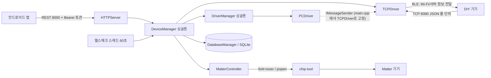
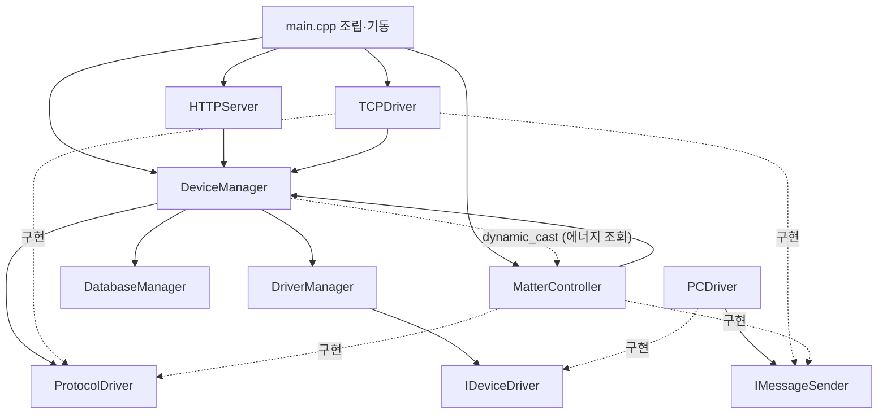
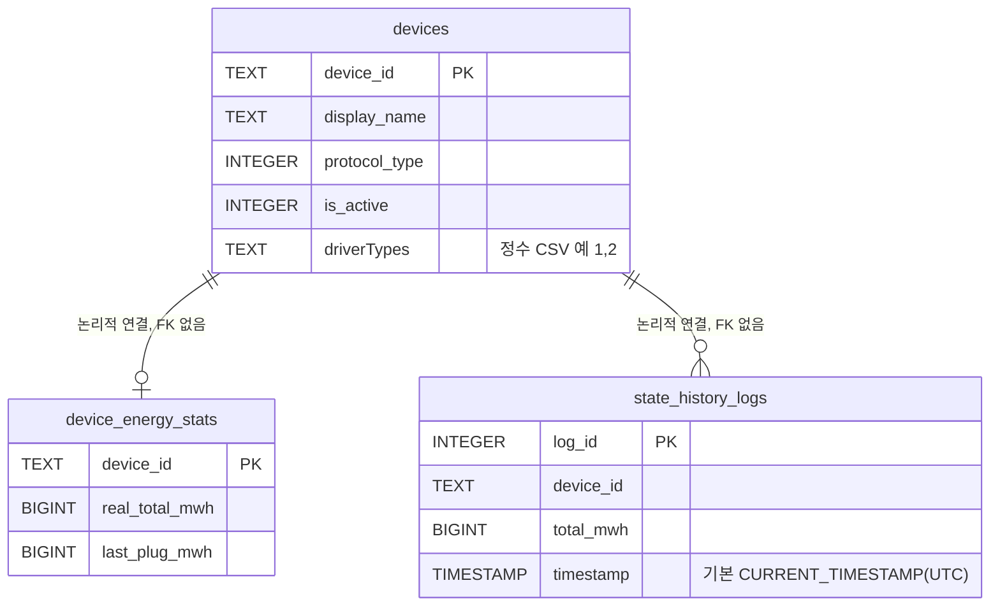
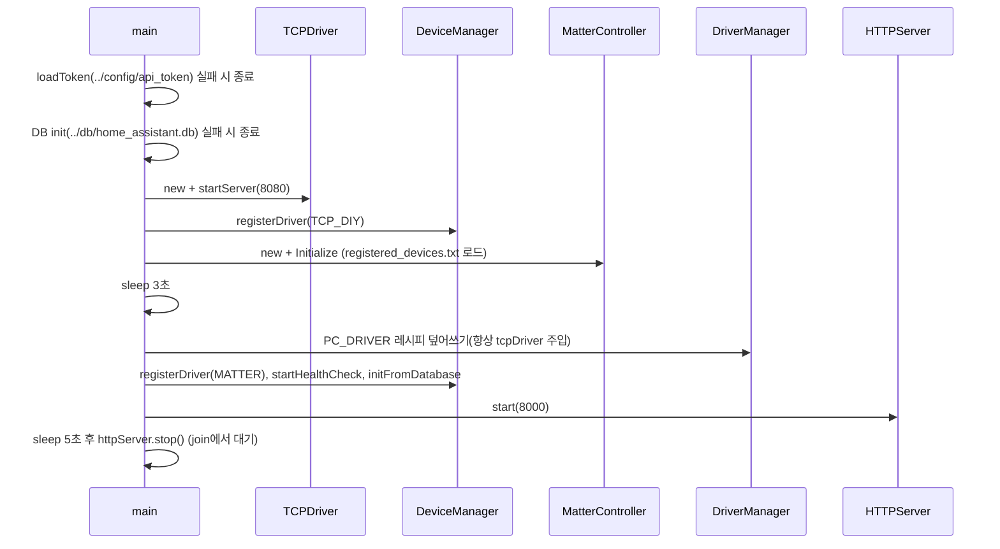
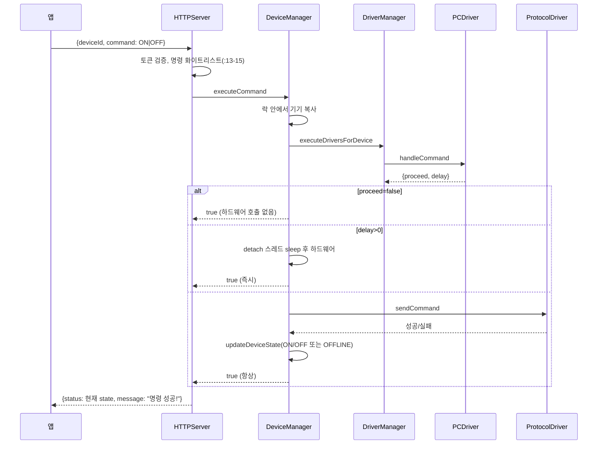
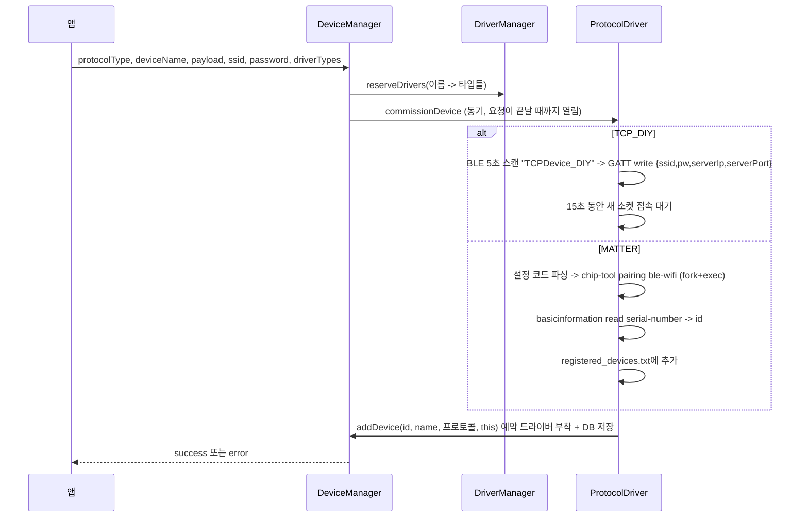

# HomeAssistantServer(home-assistant-core) — As-Is 설계

- 분석 기준: main 브랜치 HEAD 4875445 (2026-11-15). 코드가 CLAUDE.md와 다르면 코드를 기준으로 함.
- 분석 범위: src/*.cpp, include/*, CMakeLists.txt, config/ 구조. 읽지 않은 것: src/json.hpp, src/httplib.h, third_party/, build/, DB 내용, config 파일 값.
- 근거 표기: `파일:줄`. 실행하지 않았음(정적 분석만). 실행·동작 미확인 항목은 "확인 필요".
- 앱(안드로이드)과 기기 펌웨어는 저장소에 없음. 프로토콜은 서버 코드에서 역으로 복원한 것.

## 1. 전체 구조

C++17 단일 프로세스 서버. 안드로이드 앱은 REST(8000)로 제어하고, DIY 기기(아두이노 등)는 서버의 TCP 8080에 접속해 줄 단위 JSON으로 통신한다. Matter 기기는 Matter SDK를 직접 쓰지 않고 외부 프로그램 `chip-tool`을 실행해 제어한다(SDK는 설정 코드 파싱에만 사용: MatterController.cpp:267). 싱글톤 `DeviceManager`가 메모리 기기 맵을 소유하고 SQLite에 영속화한다. 프로토콜별 통신은 `ProtocolDriver` 구현체가, 기기별 부가 동작(예: PC 종료 후 전원 차단 지연)은 `IDeviceDriver` 구현체가 맡는다.



## 2. 기술 스택

| 영역 | 선택 | 근거 | 비고 |
|---|---|---|---|
| 언어 | C++17 | CMakeLists.txt:5 | |
| 빌드 | CMake ≥3.10 | CMakeLists.txt:1 | 테스트·린트 설정 없음 |
| HTTP | cpp-httplib 단일 헤더 | src/httplib.h (버전 확인 필요) | 외부 코드, 수정 금지 |
| JSON | nlohmann/json 단일 헤더 | src/json.hpp (버전 확인 필요) | TCPDriver.hpp:9가 `../src/json.hpp`를 직접 include |
| DB | SQLite3 | CMakeLists.txt:80 | 단일 연결, 파일 `../db/home_assistant.db` (main.cpp:27) |
| Matter | connectedhomeip 서브모듈(정적 lib) + `chip-tool` 바이너리 | CMakeLists.txt:17-21, MatterController.cpp:34 | SDK 링크는 설정 코드 파싱만 사용 |
| BLE | SimpleBLE | CMakeLists.txt:14, TCPDriver.cpp:5 | TCP 기기 커미셔닝에만 사용 |
| 인증 | Bearer 토큰(파일), OpenSSL CRYPTO_memcmp | ApiAuth.cpp:78 | TLS 없음 |
| 링크만 되고 쓰이지 않는 것 | libevent, glib/gio, avahi, dbus | CMakeLists.txt:83-96 | src/include에서 사용처 못 찾음(확인 필요: Matter 정적 lib의 간접 의존일 수 있음) |

## 3. 모듈 설계

### 계층/의존 관계



- 순환 의존: ProtocolDriver → DeviceManager(참조, 콜백용: addDevice, hasDevice) ↔ DeviceManager → ProtocolDriver. 전방 선언으로 헤더 순환은 회피(ProtocolDriver.hpp:3).
- 계층 위반: DeviceManager가 구체 클래스 `MatterController`를 알고 `dynamic_cast`로 에너지 조회를 호출(DeviceManager.cpp:270, :289). 에너지 기능이 `ProtocolDriver` 인터페이스에 없기 때문.

### 클래스 표

| 클래스 | 책임 | 공개 인터페이스(요약) | 근거 |
|---|---|---|---|
| `main()` | 부팅 순서 조립, 종료 정리 | - | main.cpp:15-81 |
| `HTTPServer` | REST 라우팅, 인증, JSON 변환. 자체 스레드에서 `svr.listen("0.0.0.0", port)` | `start()`, `stop()` | HTTPServer.hpp:7-30, HTTPServer.cpp:43-121 |
| `ApiAuth`(namespace) | 토큰 파일 로드(권한 600 확인, 32자 이상), Bearer 비교 | `loadToken`, `isAuthorized` | ApiAuth.cpp:52-79 |
| `DeviceManager`(싱글톤) | 기기 맵 소유, 명령 실행 파이프라인, 커미셔닝 위임, 헬스체크 스레드, 에너지 조회 | `registerDriver`, `initFromDatabase`, `addDevice`, `executeCommand`, `startCommissioning`, `removeDevice`, `getDeviceState`, `startHealthCheck` 등 | DeviceManager.hpp:17-71 |
| `ProtocolDriver`(추상) | 하드웨어 프로토콜 인터페이스 | `sendCommand`, `commissionDevice`, `unpairDevice`, `readDeviceState` | ProtocolDriver.hpp:4-16 |
| `TCPDriver` | TCP 8080 수락 루프, 소켓 맵, JSON 요청/응답, BLE 커미셔닝 | 위 + `SendCommandTo`, `startServer`, `stopServer` | TCPDriver.hpp:11-35 |
| `MatterController` | `chip-tool` 실행·출력 파싱, 시리얼↔노드ID 매핑 파일 관리, 페어링 | 위 + `turnOn/Off`, `getPowerUsage`, `getCumulativeEnergy` | MatterController.hpp:15-78 |
| `IDeviceDriver`(추상) | 기기 부착 훅. 명령 전 실행, 하드웨어 진행 여부·지연 결정 | `handleCommand(device, command) -> DriverResult{proceed_hardware, delay_seconds}` | IDeviceDriver.hpp:7-18 |
| `PCDriver` | OFF 명령 시 종료 메시지 전송 후 전원 차단을 45초 지연 | `handleCommand` | PCDriver.cpp:11-35 |
| `DriverManager`(싱글톤) | 드라이버 생성 레시피 등록(`DriverRegistrar` 전역 객체), 이름 기준 예약, 부착, 순차 실행 | `registerDriver`, `reserveDrivers`, `attachReservedDrivers`, `attachDriversToDevice`, `executeDriversForDevice` | DriverManager.hpp:14-104 |
| `IMessageSender`(추상) | 대상 ID로 명령 전송(기기 드라이버가 사용) | `SendCommandTo` | IMessageSender.hpp:4-10 |
| `DatabaseManager`(싱글톤) | SQLite CRUD, 에너지 누적 보정, 시계열 | `init`, `insertDevice`, `loadAllDevices`, `updateDeviceState`, `removeDevice`, `updateEnergyStat`, `insertEnergyLog`, `getEnergyHistory` | DatabaseManager.hpp:12-40 |
| `Device`(구조체) | id, name, protocol_type, state, attached_drivers, driver_types | - | Device.hpp:16-31 |

열거형: `ProtocolType {MATTER=0, TCP_DIY=1, UNKNOWN=2}`(Device.hpp:9-13), `DriverType {NONE=0, PC_DRIVER=1, TV_DRIVER=2, TIMER_DRIVER=3}`(DriverType.hpp:3-8). 둘 다 정수로 DB 저장. TV_DRIVER, TIMER_DRIVER는 구현체가 없음.

## 4. 스레드 모델과 락

| 스레드 | 생성 | 하는 일 | 근거 |
|---|---|---|---|
| main | 프로세스 | 조립 후 `httpServer.stop()`의 join에서 영구 대기 | main.cpp:74 |
| TCP 수락 | `TCPDriver::startServer` | `accept` 루프, 소켓 맵 등록 | TCPDriver.cpp:163, :204-227 |
| HTTP 서버 | `HTTPServer::start` | `svr.listen`. 요청은 httplib 내부 스레드풀이 처리(풀 크기: 확인 필요) | HTTPServer.cpp:28, :120 |
| 헬스체크 | `DeviceManager::startHealthCheck` | 60초마다 전체 기기 상태·에너지 점검 | DeviceManager.cpp:203, :218-259 |
| 지연 명령 | `executeCommand`가 매번 detach | sleep 후 하드웨어 명령 | DeviceManager.cpp:132-135 |
| 언페어 | `removeDeviceRegistration`이 detach | chip-tool unpair 실행 | MatterController.cpp:216-226 |

| 락 | 보호 대상 | 비고 |
|---|---|---|
| `DeviceManager::mutex_` | `devices_`, `drivers_` 쓰기(registerDriver) | `drivers_` 읽기는 대부분 락 밖(DeviceManager.cpp:116, :147, :186). `getDeviceActivePower/TotalEnergy`는 chip-tool 실행 동안 락 유지(:262-277, :281-296). `removeDevice`는 `unpairDevice` 호출 동안 락 유지(:159-169) |
| `TCPDriver::sockets_mutex_` | `client_sockets_` | `SendCommandTo("ALL")`는 락 없이 순회(TCPDriver.cpp:317) |
| `DriverManager::mutex_` | `pending_drivers_` | `creators_`는 락 없음(전역 등록은 main 이전, main.cpp:50 재등록은 HTTP 시작 전) |
| 락 없음 | `MatterController`의 `mSerialToNodeId`, `mOfflineNodes`, `mPairingNodes` | HTTP 스레드·헬스체크·detach 스레드가 동시 접근 |
| 락 없음 | `DatabaseManager`의 단일 `sqlite3*` | SQLite 직렬화 모드에 의존(컴파일 옵션 확인 필요) |

## 5. 데이터 모델 (SQLite, DatabaseManager.cpp)



- 정의: devices :12-17, device_energy_stats :143-146, state_history_logs :203-207.
- 외래키·인덱스·스키마 버전 없음. 기기 삭제 시 devices 행만 삭제(:129-140).
- `is_active`만 저장하므로 재시작하면 `ON`/`OFF` 두 값만 복원(:86).
- 에너지 보정: `real_total += max-delta`, 카운터가 줄면 현재값을 통째로 더함(:176-183).
- 파일 기반 저장소: `config/registered_devices.txt`(줄당 `시리얼,노드ID`, MatterController.cpp:44-57, :245-248). DB와 별개로 관리되는 두 번째 저장소.
- 설정 파일: `config/api_token`(비밀, 값 미기록), 상대 경로 `../config`, `../db`, `../third_party/...`, `../paa_certs/...` 때문에 `build/`에서 실행해야 함.

## 6. 주요 흐름

### 6.1 부팅 (main.cpp)


근거 main.cpp:19-80. 아래 순서 문제는 문제점.md 참고: startHealthCheck가 initFromDatabase보다 먼저(:55-56), 이후 종료 코드는 도달하지 않음(:74-79).

### 6.2 기기 제어 `POST /api/control`


근거 DeviceManager.cpp:96-142, HTTPServer.cpp:146-183. PCDriver는 OFF일 때 `SendCommandTo("ALL", SYSTEM/SHUTDOWN)`을 TCP 기기 전체에 보내고 45초 지연을 요구(PCDriver.cpp:14-30).

### 6.3 커미셔닝 `POST /api/commission`


근거 DeviceManager.cpp:143-157, TCPDriver.cpp:61-157, MatterController.cpp:250-306, :400-407, :396-399. TCP의 payload는 서버 IP(비면 하드코딩 기본값 TCPDriver.cpp:62), Matter의 payload는 수동 설정 코드. Matter 노드 ID는 `time(nullptr)`(MatterController.cpp:397).

### 6.4 헬스체크 (60초)

`getAllDevices` 복사 → 각 기기 `getDeviceState`(드라이버 `readDeviceState`) → 결과가 UNKNOWN이면 상태 미갱신, 그 외 `updateDeviceState`(DB 반영) → OFFLINE/UNKNOWN이면 DB `is_active=0` → Matter 기기가 온라인이면 `getDeviceEnergyInfo` → `insertEnergyLog`. 근거 DeviceManager.cpp:218-259.
Matter 오프라인 판정: chip-tool 출력에서 성공 문자열이 없거나 오류 키워드가 있으면 `mOfflineNodes`에 기록하고, 자동 점검은 이후 chip-tool 실행을 건너뜀(MatterController.cpp:141-178, :428-431). 이 명부에서 빠지는 경우는 chip-tool을 실행하는 호출이 성공했을 때(수동 새로고침 `isManualRefresh=true`, 제어 명령, 누적 전력량 조회 등, :172-175, :428)뿐이라 자동 점검만으로는 복구되지 않음.

### 6.5 TCP 기기 접속

수락 루프가 `accept` 후 `ARD_<클라이언트IP>`를 ID로, 소켓 fd를 맵에 저장(TCPDriver.cpp:204-226). 접속 시 기기가 먼저 보내는 메시지·인증은 없음. 이후 서버가 요청을 보내고 1초 안에 한 번 `recv`(512바이트)로 응답을 읽음(:287-293). 송신 실패·무응답이면 소켓을 닫고 맵에서 제거(:275-297) → 기기가 다시 접속할 때까지 OFFLINE.

## 7. 외부 인터페이스

### 7.1 REST (포트 8000, 0.0.0.0, HTTP 평문)

모든 요청에 `Authorization: Bearer <토큰>` 필요. 미인증 401 + `WWW-Authenticate: Bearer`(HTTPServer.cpp:47-57, pre-routing 핸들러).
오류 판정: 응답 본문에 문자열 `"error"`가 있으면 HTTP 400(:66, :73, :81, :108). 그 외 오류 상황도 200일 수 있음.

| 메서드 경로 | 요청 | 성공 응답 | 오류/특이 사항 | 근거 |
|---|---|---|---|---|
| GET `/api/devices` | - | `{status:"success", total_count, devices:[{id,name,type,state}]}` | | HTTPServer.cpp:59-62, :123-144 |
| POST `/api/control` | `{deviceId, command:"ON"\|"OFF"}` | `{status:<현재state>, message:"명령 성공!"}` | 기기 없음: 200 + "명령 실패!"(status UNKNOWN). 허용 외 명령·JSON 오류: `{"result":"error",...}` 400 | :64-70, :146-183 |
| POST `/api/commission` | `{payload, deviceName, protocolType:"MATTER"\|"TCP_DIY", ssid?, password?, driverTypes?:[int]}` | `{result:"success", message}` | 실패 `{"result":"error"}` 400. 동기(분 단위 대기 가능) | :71-77, :185-229 |
| POST `/api/devices/delete` | `{deviceId}` | `{result:"success",...}` | 기기 없음/드라이버 해제 실패 시 error 400 | :79-85, :231-249 |
| GET `/api/devices/{id}/state?isManualRefresh=true\|false` | - | `{deviceId, state}` | 없는 기기도 200 + "UNKNOWN". 호출 시 실제 기기 조회 수행 | :87-104 |
| GET `/api/devices/{id}/energy` | - | `{device_status, activePower_mW, totalEnergy_mWh}` | 미등록 기기 `{"error"}` 400. 조회 후 존재 확인(:258-260 순서) | :105-112, :251-273 |
| GET `/api/devices/{id}/energy/history` | - | `{device_status, logs:[{timestamp,totalEnergy_mWh}]}` (최대 50건, 오래된 순) | 미등록 기기는 본문에 error지만 상태코드 200(:114-118은 400 변환 없음) | :114-118, :275-304, DatabaseManager.cpp:234-263 |

상태 값(문자열, 열거형 아님): ON, OFF, OFFLINE, UNKNOWN, PAIRING, ERROR, 그리고 TCP 기기가 보고하는 임의 문자열(TCPDriver.cpp:258). 확인 필요: 앱이 기대하는 값 전체(앱 코드 없음).

### 7.2 TCP 8080 JSON 프로토콜 (서버 코드에서 복원)

전송 형식: JSON 객체 1개 + `\n`(TCPDriver.cpp:282). 응답은 줄 단위 JSON, 여러 줄이면 마지막 유효 줄을 사용(:300-312).

| 방향 | 메시지 | 용도 | 근거 |
|---|---|---|---|
| 서버→기기 | `{"action":"CONTROL","target":"RELAY","value":"ON"\|"OFF"}` | 제어 | TCPDriver.cpp:40-42 |
| 기기→서버 | `{"status":"success"}` 또는 `{"status":"error","message":"..."}` | 제어 응답 | :52-58 |
| 서버→기기 | `{"action":"GET_STATE"}` | 상태 조회 | :249-250 |
| 기기→서버 | `{"state":"<문자열>"}` | 상태 응답 | :254-258 |
| 서버→기기 | `{"action":"SYSTEM","target":"OS","value":"SHUTDOWN"}` | PC 종료 | PCDriver.cpp:21-25 |
| 서버→기기 | `{"action":"RESET"}` | 삭제 시 초기화(응답 읽지 않음) | TCPDriver.cpp:237-238 |
| 기기→서버 | (접속 자체) | ID는 `ARD_<IP>`로 서버가 부여. 접속 시 인증·핸드셰이크 없음 | :221 |

- `sendCommand`에 `{`로 시작하는 문자열이 오면 파싱해 그대로 전송(:31-37). PCDriver가 이 경로를 사용.
- BLE 커미셔닝: 기기 이름 `TCPDevice_DIY`를 5초 스캔(:78, :84), 서비스 `19b10000-e8f2-537e-4f6c-d104768a1214`의 특성 `19b10001-...`에 `{"ssid","pw","serverIp","serverPort":8080}` JSON을 write_request(:96-105). 평문 전송 여부는 BLE 보안 설정에 따라 다름(확인 필요).

### 7.3 chip-tool 호출 (MatterController.cpp)

경로 `../third_party/connectedhomeip/out/host/chip-tool`(:34). 완료 판단은 출력 문자열 매칭.

| 용도 | 명령 | 실행 방식 | 근거 |
|---|---|---|---|
| 페어링 | `pairing ble-wifi <nodeId> str:<ssid> str:<pw> <pin> 3830 --paa-trust-store-path ../paa_certs/paa-root-certs` | fork+execv(셸 미사용), 성공: "Device commissioning completed with success" 또는 "CHIP_NO_ERROR" | :275-290 |
| 시리얼 조회 | `basicinformation read serial-number <nodeId> 0` | popen(셸), 출력의 "SerialNumber:" 또는 "Data =" 파싱 | :312-347 |
| 켜기/끄기 | `onoff on\|off <nodeId> <endpoint=1>` | popen + `timeout 5`, 성공 키워드 4종 / 오류 키워드 5종 | :141-177, :358, :375 |
| 상태 | `onoff read on-off <nodeId> 1` | 위와 동일, "Data = true/false" | :434-446 |
| 순간 전력 | `electricalpowermeasurement read active-power <nodeId> 1` | "ActivePower:" 파싱, 단위 mW 가정 | :464-478 |
| 누적 전력량 | `electricalenergymeasurement read cumulative-energy-imported <nodeId> 1` | "Energy:" 파싱, mWh 가정(`2>&1` 없음) | :496-509 |
| 언페어 | `pairing unpair <nodeId> 2>&1` | detach 스레드 + popen | :214-226 |

기기 ID: TCP는 `ARD_<IP>`, Matter는 시리얼 번호(시리얼 읽기 실패 시 `UNKNOWN_SERIAL_<nodeId>`, :347). 시리얼↔노드ID 변환은 `registered_devices.txt`와 메모리 맵(:524-530).

## 8. 폴더 구조

```
.
├── CMakeLists.txt
├── CLAUDE.md, README.md(2줄)
├── src/        main, HTTPServer, DeviceManager, DatabaseManager, TCPDriver, MatterController, PCDriver, ApiAuth, (httplib.h, json.hpp: 외부)
├── include/    각 클래스 헤더 + CHIP 설정 헤더 2개(SystemProjectConfig.h, CHIPProjectConfig.h)
├── config/     api_token(비밀, 미추적), registered_devices.txt(미추적)
├── db/         home_assistant.db(미추적)
├── paa_certs/  Matter PAA 루트 인증서(추적)
├── third_party/connectedhomeip  서브모듈(미분석)
├── build/      빌드 산출물(미추적)
├── lib/        비어 있음
└── tests/      없음
```
.gitignore: build/, db/home_assistant.db, config/registered_devices.txt, config/api_token, .ua/. CI(.github) 없음.

## 9. 요구사항 대응표

요구사항 문서가 없으므로(docs/01_요구사항.md 없음, 추정: 1단계에서 작성) 해당 없음. 기능 ID는 기능목록.md의 F-ID 사용.

## 10. 확인 필요 (코드만으로 판단 불가)

1. httplib 스레드풀 크기·예외 처리(핸들러에서 json 외 예외가 나면 어떻게 되는지) — httplib.h를 읽지 않음.
2. SQLite 컴파일 스레드 모드(직렬화 여부).
3. 앱이 기대하는 상태 문자열과 응답 형식.
4. 기기 펌웨어의 실제 프로토콜(접속 직후 메시지, 응답 크기, BLE 보안).
5. libevent/glib/avahi/dbus 링크의 필요 여부.
6. 실제 chip-tool 출력 형식과 버전(문자열 매칭 의존).
7. Matter 장치 종류별 endpoint=1 가정이 맞는지(MatterController.cpp:392, :434).
8. `registered_devices.txt`와 DB의 현재 일치 여부(값을 읽지 않음).
