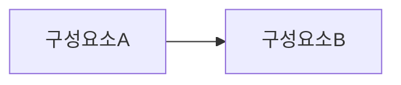
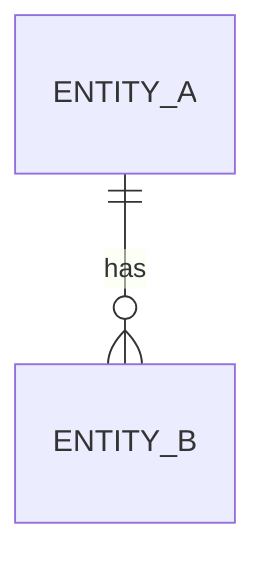
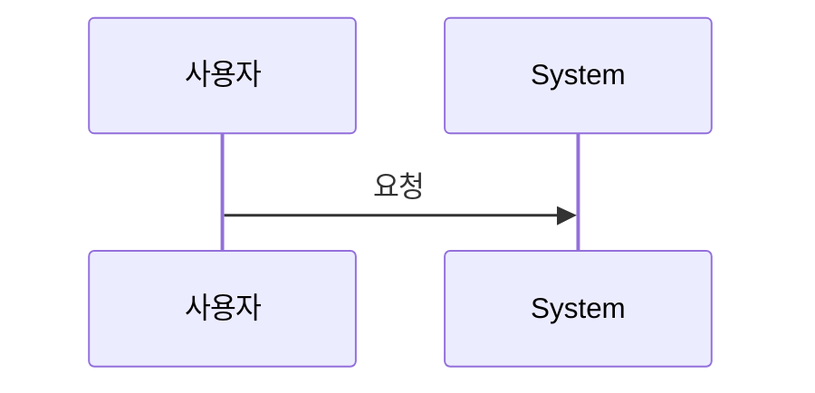

# <프로젝트 이름> — 설계

## 1. 전체 구조
(구성 요소와 관계를 한 문단으로 설명)



## 2. 기술 스택
| 영역 | 선택 | 이유 | 관련 ADR |
|---|---|---|---|
| 언어 | | | |

## 3. 모듈 설계
### <모듈 이름>
- **책임**:
- **공개 인터페이스**: (함수·클래스·API 시그니처)
- **의존**:

## 4. 데이터 모델


## 5. 주요 흐름
### <핵심 기능 이름>


## 6. 요구사항 대응표
| REQ-ID | 담당 모듈 | 비고 |
|---|---|---|
| REQ-01 | | |

## 7. 폴더 구조
```
src/
tests/
```

## 8. 구현 순서
1.

## 9. 리뷰 반영
| 출처 (Gemini / 보안 / 사용자) | 지적 | 반영 여부 | 이유 |
|---|---|---|---|
