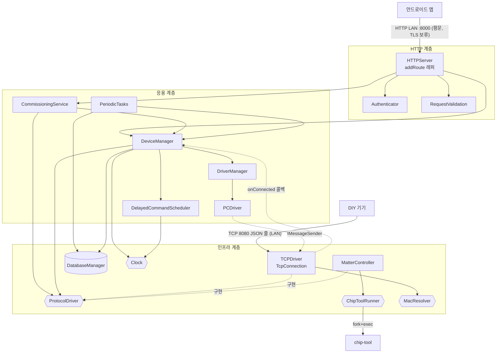
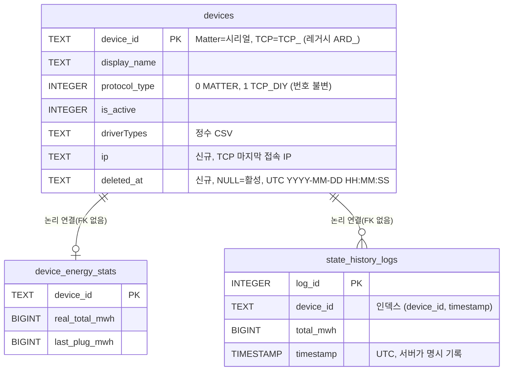
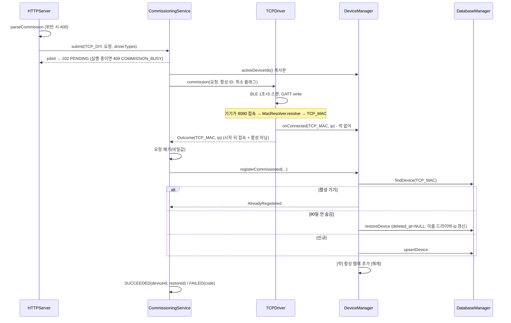
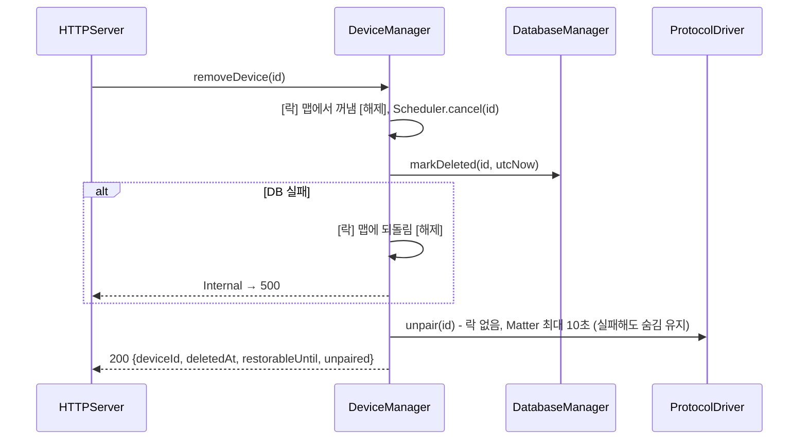

# home-assistant-core — 설계 (To-Be)

| 항목 | 값 |
|---|---|
| 상태 | **초안(사용자 승인 전)**. 2026-11-17 작성, 2026-11-18 수정 1회(LAN 우선·보안 점검 반영·압축, 압축 전 사본 `docs/archive/`) |
| 입력 | `01_요구사항.md`, `03_설계결정/Q-선택지-초안.md`, `analysis/as-is-설계.md`·`문제점.md`(기준 4875445), `reviews/security-design-2026-11-17.md`, `api-contract.md` v1.0 |
| 관련 | ADR-001~011(`docs/03_설계결정/`), 계약 초안 `docs/api-contract-v2.0-초안.md` |

**지금 상태 / 다음 할 일**
- 지금: 3계층 + 생성자 주입 설계 초안. 외부 접속(VPN·TLS)은 **보류**, 서버는 집 LAN `0.0.0.0:8000` 평문(ADR-011).
- 보안 점검 중(13건): 반영 11, 일부 보류 2(외부 접속 전제 부분). 9절.
- 다음: 사용자 설계 승인 → 계약 v2.0 확정(앱 팀 중개) → 3단계 구현 1번(8절). ADR-006·008은 실기 C-1~C-6 뒤 확정.

> ID: `N-0x(신규)` = 설계 중 새로 찾은 문제(01 E2 항상 true / 02 E7 순서 설명 오류 / 03 POST 401 끊김). `N-xx` = `analysis/문제점.md`. `S-xx` = 보안 점검.

## 0. As-Is → To-Be

| 관점 | As-Is | To-Be | ADR |
|---|---|---|---|
| 객체·의존 | 싱글톤 3개, 드라이버가 `DeviceManager&` 역호출 | `main`이 생성·주입(Composition Root), 위→아래 한 방향 | 001 |
| 락 | 락 안에서 chip-tool·다른 락(교착), Matter 맵 무락 | 한 번에 락 하나, 락 안엔 메모리만(3.4) | 002 |
| 결과·오류 | `bool`(항상 true), 본문 문자열로 상태코드 | `CommandResult`·`ErrorCode` → 단일 매핑 표 | 003 |
| 스레드 | `detach`, 종료 코드 도달 불가 | 모두 소유·join, `sigwait` | 010 |
| TCP | 512B 1회 recv, 무락, fd 누수, ID `ARD_<IP>` | `TcpConnection`(RAII·줄 버퍼·락·상한), ID `TCP_<MAC>` | 006 |
| 삭제·이력 | 행 삭제, 보관 정책 없음 | 숨김(90일 복구), 이력 90일, 기간·집계 | 007 |
| 인증·바인딩 | 본문 전 401(POST 끊김), `0.0.0.0` 평문 | `addRoute` 래퍼·상한 / 바인딩 그대로 + `HAC_HTTP_BIND`, 외부 접속 보류 | 009·011 |
| 커미셔닝 | 동기, 비밀값 argv | 비동기 작업 ID, stdin + 입력 검증·출력 마스킹 | 008 |
| 테스트 | 없음 | GoogleTest/Mock, 가짜 드라이버·시계, `ctest` | 004 |

## 1. 전체 구조

3계층(Layered): **HTTP**(검증·인증·JSON) → **응용**(규칙·스레드 수명) → **인프라**(TCP·chip-tool·BLE·SQLite·시계, 인터페이스 뒤). 아래→위 알림(TCP 접속)은 `main`이 연결한 콜백(Observer). `{{ }}`는 테스트에서 가짜로 바꾸는 인터페이스.



## 2. 기술 스택

| 영역 | 선택 | 이유 | ADR |
|---|---|---|---|
| 언어·빌드 | C++17, CMake (유지) | G-1, NFR-07 | — |
| HTTP / JSON | cpp-httplib, nlohmann/json (유지, 수정 금지) | 이미 사용 | 009 |
| DB | SQLite3 + `PRAGMA user_version` | 표준 기능으로 스키마 버전 | 007 |
| Matter / BLE | chip-tool(`interactive start` + stdin) / SimpleBLE (유지) | 비밀값을 argv에서 뺌 | 008 |
| 테스트 | GoogleTest+GoogleMock(FetchContent 고정), TSan(CMake 옵션) | Q-01, REQ-01 | 004 |
| 외부 접속 | **보류**(Tailscale 안은 ADR-005에 기록만) | 사용자 결정 11-18 | 005·011 |

## 3. 모듈 설계

### 3.1 모듈 책임

| 모듈 | 계층 | 책임 | 의존 | 기존 |
|---|---|---|---|---|
| `main.cpp` | 조립 | 생성·주입·시작 순서, `HAC_HTTP_BIND` 읽기, `sigwait`, 종료 순서 | 전부 | 수정 |
| `HTTPServer` | HTTP | `addRoute`(인증·예외·오류 매핑 강제), JSON 변환, 본문·연결 상한, `clientAddressOf` | DM, CS, Auth, Validation | 수정 |
| `Authenticator`/`BearerTokenAuthenticator` | HTTP | 인증 판정(Strategy), 기존 `ApiAuth` 사용 | ApiAuth | 신규 |
| `RequestValidation` | HTTP(순수) | E3·E7 파싱·검증(예외 없음), deviceId 형식, 로그 정제 | — | 신규 |
| `ErrorMapping` | HTTP | `ErrorCode` → HTTP·코드·고정 문구 | — | 신규 |
| `DeviceManager` | 응용 | 활성 기기 맵, 명령 파이프라인, 등록·복구·숨김 삭제, 에너지·이력, TCP ID 이전 | PD, DRM, SCH, DB, Clock | 재작성 |
| `CommissioningService` | 응용 | 작업 1개씩(스레드 1), 작업 상태(메모리, 요청 미보관), 취소 | PD, DM | 신규 |
| `DelayedCommandScheduler` | 응용 | 기기당 지연 명령 1개 보관·취소·만기 실행 | Clock | 신규 |
| `PeriodicTasks` | 응용 | 60초 헬스체크, 시작 1시간 뒤·24시간마다 정리 | DM, DB, Clock | 신규(분리) |
| `DriverManager`/`PCDriver` | 응용 | 기기 드라이버 생성·부착·실행 / OFF 시 종료 메시지 + 45초 지연 | IDeviceDriver, IMessageSender | 수정(N-08) |
| `TCPDriver` | 인프라 | 8080 수락·상한, 연결 맵, MAC→ID, 교체 규칙, BLE 커미셔닝, 브로드캐스트 | MacResolver, SimpleBLE | 재작성 |
| `TcpConnection` | 인프라 | fd RAII, 줄 버퍼(4KiB), 요청·응답 1쌍 직렬화 | — | 신규 |
| `MacResolver`/`ProcNetArpResolver` | 인프라 | IPv4→MAC(`/proc/net/arp`·`route` 읽기), 서브넷·게이트웨이 거부 | — | 신규 |
| `MatterController` | 인프라 | chip-tool 명령, 시리얼↔노드ID 맵(락), 매핑 파일 | ChipToolRunner | 수정 |
| `ChipToolOutputParser` | 인프라 | 출력 → 값/오류(예외 없음) | — | 신규(이동) |
| `ChipToolRunner`/`ProcessChipToolRunner` | 인프라 | 셸 없이 fork+exec, stdin, 제한 시간, 출력 마스킹, 전체 취소 | — | 신규 |
| `DatabaseManager` | 인프라 | 연결·뮤텍스, 백업·마이그레이션, CRUD, 정리. **질의는 바인딩 파라미터만**(S-10) | sqlite3 | 수정 |
| `EnergyAggregation` | 응용(순수) | 시계열 → 일/주/월(+09:00, 월요일 시작) | — | 신규 |
| `Clock`/`SystemClock` | 인프라 | steady·UTC 시각(테스트 `FakeClock`) | — | 신규 |

### 3.2 공개 인터페이스

표기: 인터페이스 클래스는 모두 `virtual ~X() = default;`를 가진다(아래 생략).

```cpp
// Result 패턴: 예상 가능한 실패는 값으로
enum class ErrorCode { None, InvalidRequest, UnsupportedOperation, Unauthorized, NotFound,
    DeviceNotFound, JobNotFound, CommandBlocked, CommissionBusy, DeviceUnreachable,
    CommissionFailed, CommissionTimeout, Cancelled, AlreadyRegistered, Internal };
struct Error { ErrorCode code = ErrorCode::None; std::string message; };   // message는 로그 전용(S-11)
struct Status { Error error; bool ok() const { return error.code == ErrorCode::None; } };
template <typename T> struct Result { std::optional<T> value; Error error; bool ok() const; };

enum class Command { On, Off };                                  // REST "ON"/"OFF"
enum class CommandOutcome { Succeeded, Accepted, Failed };
struct CommandResult { CommandOutcome outcome; Error error /*Failed*/; std::string state /*응답 시점*/;
                       Command pendingCommand /*Accepted*/; int delaySeconds = 0 /*Accepted, 남은 초*/; };

struct DriverResult { enum class Action { Proceed, Block, Delay } action = Action::Proceed; int delaySeconds = 0; };
class IDeviceDriver { public: virtual DriverResult handleCommand(const Device& device, Command command) = 0; };
class IMessageSender {   // TCPDriver만 구현
public:
    virtual Status sendTo(const std::string& deviceId, const std::string& jsonLine) = 0;
    virtual void broadcast(const std::string& jsonLine) = 0;    // 기존 "ALL" 대체
};

struct CommissionRequest { std::string name, payload, ssid, password; };  // password·payload 로그 금지
struct CommissionOutcome { std::string deviceId; std::string ip; };      // ip는 TCP만
struct EnergyReading { int64_t activePower_mW; int64_t cumulative_mWh; };
class ProtocolDriver {   // DeviceManager& 역참조 제거
public:
    virtual Status sendCommand(const std::string& deviceId, Command command) = 0;
    virtual Result<std::string> readState(const std::string& deviceId, bool isManualRefresh) = 0;
    virtual Result<CommissionOutcome> commission(const CommissionRequest& request,
        const std::unordered_set<std::string>& activeDeviceIds,   // 호출 시점 복사본(락 회피)
        const std::atomic<bool>& cancelRequested) = 0;
    virtual Status unpair(const std::string& deviceId) = 0;
    virtual Result<EnergyReading> readEnergy(const std::string& deviceId);  // 기본 미지원, Matter만 재정의
};

struct TcpConnectionInfo { std::string deviceId; std::string ip; };
class MacResolver {      // "AABBCCDDEEFF". 다른 서브넷·게이트웨이 MAC·미완성 항목이면 nullopt(S-04)
public: virtual std::optional<std::string> resolve(const std::string& clientIpv4, const std::string& localIpv4) = 0;
};
class TCPDriver : public ProtocolDriver, public IMessageSender {
public:
    TCPDriver(int port, MacResolver& macResolver);
    void setConnectionListener(std::function<void(const TcpConnectionInfo&)> listener);  // start 전 1회
    void start();
    void stop();         // listen fd shutdown → accept 해제 → join → 연결 close
};

struct ProcessResult { int exitCode = -1; std::string output; bool timedOut = false; bool cancelled = false; };
class ChipToolRunner {   // Adapter
public:
    virtual ProcessResult run(const std::vector<std::string>& args, const std::string& stdinText /*비밀값은 여기만*/,
        std::chrono::seconds timeout, const std::vector<std::string>& secretsToMask /*output에서 ***(S-08)*/) = 0;
    virtual void cancelAll() = 0;   // 새 실행 거부 + 자식 SIGTERM → 1초 뒤 SIGKILL
};

class DeviceManager {
public:
    DeviceManager(DatabaseManager& db, DriverManager& deviceDrivers, DelayedCommandScheduler& scheduler, Clock& clock);
    void registerProtocol(ProtocolType type, ProtocolDriver& driver);   // 부팅 때만
    Status loadFromDatabase();                                          // 활성 기기만
    std::vector<Device> listDevices() const;                            // 숨김 제외
    std::unordered_set<std::string> activeDeviceIds() const;
    CommandResult executeCommand(const std::string& deviceId, Command command);
    Result<std::string> refreshState(const std::string& deviceId, bool isManualRefresh);
    Result<EnergySnapshot> readEnergy(const std::string& deviceId);     // 존재·프로토콜 먼저
    Result<HistoryResult> getEnergyHistory(const std::string& deviceId, const HistoryQuery& query);
    Result<RegisterOutcome> registerCommissioned(ProtocolType type, const CommissionOutcome& outcome,
        const std::string& name, const std::vector<DriverType>& driverTypes);  // 숨김이면 복구, 활성이면 AlreadyRegistered
    Result<DeleteOutcome> removeDevice(const std::string& deviceId);    // 숨김 삭제
    void onTcpConnected(const TcpConnectionInfo& info);                 // ip 갱신, 레거시 이전(4.2)
    void runHealthCheck();
};
class DelayedCommandScheduler {
public:
    explicit DelayedCommandScheduler(Clock& clock);
    bool schedule(const std::string& deviceId, Command command, std::chrono::seconds delay,
                  std::function<void()> task);                          // 기기당 1개, 있으면 false
    std::optional<PendingCommand> pending(const std::string& deviceId) const;
    bool cancel(const std::string& deviceId);
    void tick(std::chrono::steady_clock::time_point now);               // 테스트는 직접 호출
    void start();
    void stopAndCancelAll();                                            // 취소 + 기기별 로그(Q-06 B)
};
class CommissioningService {
public:
    CommissioningService(DeviceManager& devices, std::unordered_map<ProtocolType, ProtocolDriver*> drivers);
    Result<std::string> submit(ProtocolType type, CommissionRequest request,
                               std::vector<DriverType> driverTypes);    // 실행 중이면 CommissionBusy
    Result<JobStatus> getJob(const std::string& jobId) const;           // jobId·state·deviceId·restored·error code만
    void start();
    void stop();                                                        // 취소 + join
};
class Clock {
public:
    virtual std::chrono::steady_clock::time_point steadyNow() const = 0;   // 타이머
    virtual std::chrono::system_clock::time_point utcNow() const = 0;      // 기록 시각
};

class Authenticator { public: virtual bool isAuthorized(const std::string& authorizationHeader) const = 0; };
struct ApiResponse { int httpStatus; nlohmann::json body; };
using RouteHandler = std::function<ApiResponse(const httplib::Request&)>;
class HTTPServer {
public:
    HTTPServer(DeviceManager&, CommissioningService&, const Authenticator&,
               std::string bindAddress /*main이 HAC_HTTP_BIND, 기본 0.0.0.0*/, int port);
    bool start();
    void stop();                                                   // svr.stop() 후 join (N-12)
private:
    void addRoute(HttpMethod method, const std::string& pattern, RouteHandler handler);  // 유일한 등록 경로
    static std::string clientAddressOf(const httplib::Request& request);  // 주소 판정 한 곳(지금 remote_addr)
};
namespace RequestValidation {   // 순수 함수, 예외 없음
    Result<CommissionInput> parseCommission(const nlohmann::json& body);          // S-09
    Result<HistoryQuery> parseHistoryQuery(const httplib::Params& params);        // S-10
    bool isValidDeviceId(const std::string& deviceId);                            // [A-Za-z0-9_-]{1,64}
    std::string sanitizeForLog(const std::string& text, size_t maxLength = 200);  // 제어문자→?
}
```

`DatabaseManager`(내부 뮤텍스): `open(path)`(백업·마이그레이션), `upsertDevice`, `loadActiveDevices`, `findDevice(id)`(활성/숨김 구분), `markDeleted`, `restoreDevice`, `updateDeviceState`, `updateDeviceIp`, `renameDeviceId(old, new)`(트랜잭션), `updateEnergyStat`, `insertEnergyLog(id, total, utcTime)`, `queryHistory(id, fromUtc, toUtc, limit)`, `latestHistoryTime()`, `purgeExpired(cutoffUtc, maxDeleteRatio)`(건너뜀 여부 반환), `close`.

### 3.3 명령 실행 규칙 (REQ-07·08) — 흐름도 대신 이 표가 E2 흐름이다

| 단계 | 규칙 |
|---|---|
| 1 | `[락]` 기기 복사 `[해제]`. 없음/숨김 → `Failed(DeviceNotFound)` |
| 2 | 같은 명령이 지연 대기 중 → 드라이버 재실행 없이 `Accepted(남은 초)` |
| 3 | 다른 명령이 지연 대기 중 → 대기 취소, 로그, 계속 |
| 4 | 기기 드라이버(락 없음): `Block` 하나라도 → `Failed(CommandBlocked)` / `Delay` 최댓값 → `schedule` 후 `Accepted`(PCDriver: 종료 메시지 broadcast + 45초) |
| 5 | 즉시: 성공 → 상태 갱신 → `Succeeded` / 실패 → `OFFLINE`, `Failed(DeviceUnreachable)` / `Cancelled`(종료 중) → 갱신 안 함 |
| 6 | 지연 만기: 스케줄러 스레드가 5와 같게 실행(결과는 로그·상태만, 앱은 E5로 확인) |

### 3.4 스레드·락 규칙 (REQ-01·06, NFR-01)

| 스레드 | 소유 | 하는 일 | 종료 |
|---|---|---|---|
| main | — | 조립 후 `sigwait(SIGTERM, SIGINT)`(다른 스레드 생성 전 `pthread_sigmask`로 막음) | 3.6 |
| HTTP listen + 풀(8) | HTTPServer | 요청 처리 | `svr.stop()` |
| TCP 수락 | TCPDriver | `accept`, 상한, MAC 조회, 교체 규칙, 콜백 | listen fd `shutdown` → join |
| 지연 명령 / 주기 작업 | Scheduler / PeriodicTasks | 만기 작업 / 헬스체크·정리 | 조건변수 → join |
| 커미셔닝 | CommissioningService | 작업 1개씩 | 취소 플래그 → join |

| 락 | 종류 | 보호 대상 | 보유 중 허용 |
|---|---|---|---|
| `DeviceManager::mutex_` | 상태 | 활성 기기 맵 | 메모리만 |
| `TCPDriver::connectionsMutex_` | 상태 | `deviceId → shared_ptr<TcpConnection>`, 연결 수 | 메모리만 |
| `TcpConnection::ioMutex_` | 자원 | 한 소켓의 요청·응답 1쌍 | 그 소켓 송수신(최대 1초) |
| `MatterController::stateMutex_` | 상태 | `mSerialToNodeId`, `mOfflineNodes`, `mPairingNodes` | 메모리만 |
| `MatterController::fileMutex_` | 자원 | `registered_devices.txt` 쓰기 | 그 파일 쓰기 |
| `DelayedCommandScheduler::mutex_` | 상태 | 대기 작업 표 | 메모리만(작업은 락 밖) |
| `CommissioningService::mutex_` | 상태 | 작업 상태 표 | 메모리만 |
| `DatabaseManager::mutex_` | 자원 | sqlite3 연결 | SQLite 호출 |

| # | 규칙 | 막는 문제 |
|---|---|---|
| L-1 | **한 번에 락 하나**. 락을 쥔 채 다른 락을 잡는 함수(다른 컴포넌트 메서드 포함)를 부르지 않는다 → 순환 대기 불가 | N-01(교착) |
| L-2 | 상태 락 안에서는 메모리만. DB·소켓·프로세스·sleep·콜백 금지 | B-07, REQ-06 |
| L-3 | 자원 락은 그 자원 입출력에만, 쥔 채 다른 락 금지 | REQ-05(b) |
| L-4 | 밖에서 쓸 데이터는 락 안에서 복사 후 락 밖에서 사용. 연결은 `shared_ptr` 복사 | B-04, REQ-05(d) |
| L-5 | 콜백(`onConnected`)·기기 드라이버(`handleCommand`)는 락 없이 호출 | N-01 |
| L-6 | 스레드는 소유하고 join. `detach` 금지 | N-13, REQ-09 |
| L-7 | 중첩이 꼭 필요하면 `DeviceManager → Scheduler → TCPDriver(연결 맵) → TcpConnection → MatterController → Database` 순서로만, 이 표 갱신 | 확장 대비 |

메모리·DB 갱신은 락 밖에서 순서대로. DB에 역순으로 쓰일 수 있는 `is_active`는 60초 헬스체크가 바로잡아 감수(ADR-002).

### 3.5 오류 응답 규약 (REQ-11, I-01~I-05, ADR-003)

본문 하나 `{"error": {"code", "message"}}`. 상태코드는 `ErrorCode`로만(I-05). **`message`는 아래 고정 문구만**, 상세(SQL·경로·chip-tool 출력·`e.what()`)는 로그만(S-11). 성공 본문에 `result`/`status`/`message` 없음. 키 lowerCamelCase, `_mW`·`_mWh`만 예외.

| ErrorCode | 코드 | HTTP | 고정 문구 | 쓰는 곳 |
|---|---|---|---|---|
| InvalidRequest | `INVALID_REQUEST` | 400 | 요청 형식이 올바르지 않습니다. | JSON·필드·명령·파라미터(E3 검증, E7 파싱) |
| UnsupportedOperation | `UNSUPPORTED_OPERATION` | 400 | 이 기기에서 지원하지 않는 요청입니다. | TCP 기기에 E6·E7 |
| Unauthorized | `UNAUTHORIZED` | 401 | 인증에 실패했습니다. | +`WWW-Authenticate: Bearer` |
| NotFound | `NOT_FOUND` | 404 | 없는 경로입니다. | 없는 경로, 형식이 틀린 deviceId(인증 뒤) |
| DeviceNotFound | `DEVICE_NOT_FOUND` | 404 | 등록되지 않은 기기입니다. | 없는·숨김 기기(I-02) |
| JobNotFound | `JOB_NOT_FOUND` | 404 | 없는 등록 작업입니다. | E8 |
| CommandBlocked | `COMMAND_BLOCKED` | 409 | 기기 드라이버가 명령을 막았습니다. | E2 |
| CommissionBusy | `COMMISSION_BUSY` | 409 | 다른 기기 등록이 진행 중입니다. | E3 |
| (httplib) | `PAYLOAD_TOO_LARGE` | 413 | (httplib 응답, C-9) | 16KiB 초과 |
| Internal | `INTERNAL_ERROR` | 500 | 서버 내부 오류입니다. | 예외·DB 오류 |
| DeviceUnreachable | `DEVICE_UNREACHABLE` | 502 | 기기가 응답하지 않습니다. | 기기·chip-tool 실패(I-01) |
| CommissionFailed | `COMMISSION_FAILED` | E8 안 | 기기 등록에 실패했습니다. | BLE 못 찾음·페어링 실패 |
| CommissionTimeout | `COMMISSION_TIMEOUT` | E8 안 | 기기 등록 시간이 초과되었습니다. | 작업 제한 시간 |
| Cancelled | `CANCELLED` | E8 안 | 서버 종료로 취소되었습니다. | 종료 중 |
| AlreadyRegistered | `ALREADY_REGISTERED` | E8 안 | 이미 등록된 기기입니다. | 결과 ID가 활성 기기(S-05) |

### 3.6 종료 순서 (REQ-09, Q-06 B: 5초 안, 코드 0, ADR-010)

| 순서 | 동작 | 상한 |
|---|---|---|
| 0 | 신호 로그, `ChipToolRunner::cancelAll()`(진행 중 요청 `Cancelled`, 상태 갱신 안 함) | 1초 |
| 1 | `HTTPServer::stop()` | ~1초 |
| 2 | `CommissioningService::stop()`(BLE 스캔 1초×5) | 1초 |
| 3 | `TCPDriver::stop()` | <1초 |
| 4 | `Scheduler::stopAndCancelAll()`(지연 OFF 취소·기기별 로그, Fail-safe) / `PeriodicTasks::stop()` | <1초 |
| 5 | `DatabaseManager::close()` → `return 0` | <1초 |

### 3.7 HTTP 보안 규칙 (REQ-15, ADR-009·011)

| 항목 | 설계 |
|---|---|
| 바인딩 | 기본 `0.0.0.0:8000`, `HAC_HTTP_BIND`. 시작 로그에 주소·"평문 HTTP" 표기 |
| 인증 위치 | `addRoute` 래퍼(본문 읽은 뒤). 마지막 `.*` 라우트로 없는 경로도 인증 뒤 404 |
| 상한(S-01) | 본문 16KiB, 읽기·쓰기 타임아웃 5초, keep-alive 5초·요청 수 제한, 풀 8. 느린 연결 테스트로 확정. 헤더 한도 C-9 |
| 입력 검증(S-09·10·15) | E3 길이·제어문자·payload 형식, E7 파싱 실패 400(예외 없음), deviceId 형식 틀리면 404 `NOT_FOUND`. 세부 규칙은 계약 초안 E3·E7 |
| 실패 로그(S-03) | `[HTTPServer] 인증 실패: <clientAddressOf> <method> <path>`, 외부 입력은 `sanitizeForLog`. 토큰은 일부도 안 남김. XFF 안 씀(보류) |
| 실패 경고·토큰(S-02) | 1분 10회 넘으면 경고 1회(차단 없음). 토큰 난수 32바이트 이상, 시작 시 32자 미만·권한 0600 초과·소유자 다름이면 경고. 교체는 파일 교체+재시작 |

### 3.8 TCP 8080 규칙 (REQ-05, ADR-006)

| 항목 | 규칙 |
|---|---|
| 상한(S-07) | 줄 4KiB(넘으면 close), 동시 연결 32(넘으면 즉시 close), 미식별 연결 30초 |
| ID | `accept` 직후 `resolve(접속 IP, 수신 IP)` → `TCP_<MAC12>`. 없으면 100ms×3 → `ip` 같은 기기 정확히 1개면 그 ID(경고) → 아니면 미식별. 다른 서브넷·게이트웨이 MAC은 식별 실패(S-04) |
| 같은 ID 연결 있음(S-04) | 기존 연결에 상태 요청 1회(1초) → 응답 있으면 새 연결 거부(오류 로그) / 없으면 기존 close 후 교체(IP 변화 경고). `ioMutex_`만 잡음 |
| 호환 | 메시지 문자열 그대로(NFR-04), 고정 샘플 회귀 테스트 |

### 3.9 테스트 (REQ-17, ADR-004)

| 종류 | 대상(가짜) | 확인 |
|---|---|---|
| 단위 | 파서, 줄 조립, ARP·route 파싱, 보정, 집계, `ErrorMapping`, `RequestValidation`(빈 값·음수·0·2^63·윤일·`2026-02-30`·`2026-13-01`·366/367일·개행 든 SSID), 마스킹, `tick`(`FakeClock`) | REQ-02·03·05(a)·12, S-09·10 |
| 통합 | DM+CS+DB(`:memory:`), `FakeProtocolDriver`·`MockMessageSender`·`FakeMacResolver` | REQ-01·04·06~08·10·13, S-05·06 |
| 통합(소켓) | `TCPDriver` 루프백, 테스트가 기기 흉내 | REQ-05, NFR-04, S-04·07 |
| 통합(HTTP) | 임시 포트 + httplib 클라이언트 | REQ-11 표, POST 401, 느린 연결(S-01), DB 오류 응답에 경로·SQL 없음(S-11) |
| 통합(DB) | v0 샘플 → 마이그레이션·백업, 정리 안전장치 | NFR-06, S-12·13 |
| TSan / 실기 | 통합을 `-DHAC_ENABLE_TSAN=ON` / `docs/07_실기시험.md`(사용자) | REQ-01 / REQ-18, 10절 |

빌드: `hac_core`(CHIP·SimpleBLE 불필요) / `hac_drivers` / `HomeAssistantCore` / `hac_tests`, `-Wall -Wextra`는 우리 대상만, `ctest --test-dir build`.

### 3.10 배포 (LAN, ADR-011)

| 항목 | 값 |
|---|---|
| 주소 | HTTP `0.0.0.0:8000` 평문(앱은 `http://<서버 LAN IP>:8000`), TCP `0.0.0.0:8080`. 포트포워딩 없음 |
| 외부 접속·TLS | **보류**(REQ-14, I-06). 붙일 때 바뀌는 곳: `HAC_HTTP_BIND=127.0.0.1` + 앞단 TLS 종단, `clientAddressOf` |
| LAN 한정 위험 | 평문 토큰(I-06), 8080 무인증·MAC 위조(A-06·S-04) → `06_배포.md`(NFR-03) |

## 4. 데이터 모델



| 스키마 변경 | SQL | 이유 |
|---|---|---|
| 버전 | `PRAGMA user_version` 0 → 1 | NFR-06 |
| `devices.ip` / `deleted_at` | `ALTER TABLE devices ADD COLUMN ip TEXT` / `... deleted_at TEXT` | ADR-006 / 007 |
| 이력 인덱스 | `CREATE INDEX IF NOT EXISTS idx_history_device_time ON state_history_logs(device_id, timestamp)` | REQ-12 |
| 시각 | `insertEnergyLog`가 `Clock::utcNow()`를 같은 문자열 형식으로(기본값 유지) | 가짜 시계 |
| 외래키 | 추가 안 함(SQLite는 테이블 재작성 필요, ID 이전과 충돌) | 정리는 코드가 한 트랜잭션 |

**마이그레이션**(시작 시 자동, NFR-06)

| 단계 | 동작 |
|---|---|
| 1 | `user_version` < 1이면 백업(S-12): `VACUUM INTO 'home_assistant.db.bak-v<현재>-<UTC시각>'`(예: `.bak-v0-20261118T093000Z`, 새 파일 O_EXCL 0600) → 열어서 `PRAGMA integrity_check`=ok → 같은 폴더 `.bak-v*` 최근 3개만(방금 만든 것은 항상 유지). 새 DB·`:memory:`는 생략. 실패하면 시작 중단 |
| 2 | 트랜잭션: ALTER·INDEX → `UPDATE devices SET ip = substr(device_id, 5) WHERE protocol_type = 1 AND device_id LIKE 'ARD_%'` → `PRAGMA user_version = 1`. 실패 시 롤백·로그·종료 |
| 3 | **레거시 ID 이전은 실행 중 지연 처리**: `onTcpConnected(TCP_<MAC>, ip)` 때 `ARD_<ip>`(활성/숨김)가 있으면 `renameDeviceId`로 3개 테이블·메모리 키를 한 번에, 로그 `[DeviceManager] ID 이전: ARD_x → TCP_y`. 조건(S-06): `TCP_<MAC>`이 활성·숨김 어디에도 없음 + `ARD_<ip>` 연결 중 아님 + `.bak-v0-*` 있음. 아니면 건너뛰고 경고 |
| 4 | 이전 전에 IP가 바뀐 기기는 짝을 못 찾음 → 삭제 후 재등록 안내. `registered_devices.txt`는 불변 |

**정리**(`PeriodicTasks`, 시작 1시간 뒤 + 24시간마다, 한 트랜잭션). 안전장치(S-13): `utcNow`가 `latestHistoryTime()`보다 90일 넘게 앞서거나, 지울 이력이 전체의 50% 초과면 건너뛰고 경고(다음 주기에 재판단).

```sql
-- :cutoff = utcNow - 90일 (모든 값은 바인딩 파라미터)
DELETE FROM state_history_logs WHERE timestamp < :cutoff;
DELETE FROM device_energy_stats WHERE device_id IN (SELECT device_id FROM devices WHERE deleted_at < :cutoff);
DELETE FROM state_history_logs  WHERE device_id IN (SELECT device_id FROM devices WHERE deleted_at < :cutoff);
DELETE FROM devices WHERE deleted_at < :cutoff;
```

## 5. 주요 흐름 (E2 제어는 3.3 표)

### 5.1 비동기 커미셔닝 + 고정 ID·복구 (TCP_DIY, REQ-10·13)



Matter도 같다(`commission` = chip-tool 페어링 → 시리얼 읽기, 숨김 삭제 때 unpair했으므로 재등록 = 재페어링).

### 5.2 숨김 삭제 `POST /api/devices/delete` (REQ-13)



## 6. 요구사항 대응표

| ID | 담당 | 설계 대응 | 릴리스 |
|---|---|---|---|
| REQ-01·06 | 전체, MatterController | 3.4, 활성 ID 복사본, chip-tool·unpair 락 밖 | 1차 |
| REQ-02 | Parser, PeriodicTasks | 예외 없는 파싱, 기기별 try/catch, 부팅 `stoull` 검증(N-11) | 1차 |
| REQ-03·04 | DeviceManager, DB | 존재·프로토콜 확인 먼저, 실패 시 통계 미갱신, insert 1회 | 1차 |
| REQ-05 | TCPDriver, TcpConnection | 3.8, `ioMutex_`, fd RAII, 브로드캐스트 복사본 | 1차 |
| REQ-07 | DeviceManager, 인터페이스 | 3.2·3.3, 생성자 주입 | 1차 |
| REQ-08 / 09 | Scheduler / main | 3.3 단계 2·3 / 3.6 | 2차 |
| REQ-10 | CommissioningService | 5.1, E8, 동시 1개 | 2차 |
| REQ-11, I-01~I-05 | HTTPServer, ErrorMapping | 3.5, 계약 v2.0 | 2차 |
| REQ-12, APP-REQ | DB, EnergyAggregation | 인덱스, 정리(4), limit 50/1000, E7 집계 | 2차 |
| REQ-13 | DeviceManager, DB | 숨김 삭제·복구·90일 완전 삭제(완료 기준은 R-1로 맞춤) | 2차 |
| REQ-14, I-06 | 배포 | **보류(나중)**. 구조만: `HAC_HTTP_BIND`, `clientAddressOf`(ADR-011) | 보류 |
| REQ-15 | HTTPServer, Authenticator | 3.7 | 2차 |
| REQ-16 | MatterController, Runner | stdin, 입력 검증, 마스킹(ADR-008) | 2차 |
| REQ-17 / 18 | tests, CMake / docs | 3.9 / `docs/07_실기시험.md`(이름 확인 필요) | 1차 |
| NFR-01·02 | 전체 | 3.4, TSan / E1·E5는 메모리, 느린 작업 락 밖, 기준 1초 | 1차 |
| NFR-03 | 전체 | 비밀값 stdin·메모리만, 로그 금지·마스킹, TLS 보류, LAN 한정 위험 문서화 | 1·2차 |
| NFR-04·05 | TCPDriver, DriverManager | 메시지 그대로·ID는 ARP만 / 인터페이스 주입, CLAUDE.md 갱신 | 1차 |
| NFR-06·07 | DB, CMake | 4 마이그레이션 / 라이브러리 분리 | 1·2차 |
| N-01~03(신규) | DM, 계약, HTTPServer | `CommandResult`(1차는 v1.0 "명령 실패!") / E7 설명 정정 / 인증 래퍼 | 1·2차 |

1차는 REST v1.0 유지(내부 재설계), REST 변경은 2차에 v2.0으로 한 번에(계약 §7).

## 7. 폴더 구조 (평평한 `src/`·`include/` 유지, 새 파일만 추가)

```
CMakeLists.txt   hac_core / hac_drivers / HomeAssistantCore / hac_tests, HAC_ENABLE_TSAN
include/         기존 + Result, Command, Clock, Authenticator, ErrorMapping, RequestValidation,
                 DelayedCommandScheduler, PeriodicTasks, CommissioningService, TcpConnection,
                 MacResolver, ChipToolRunner, ChipToolOutputParser, EnergyAggregation (.hpp)
src/             대응 .cpp (httplib.h, json.hpp 그대로)
tests/unit, tests/integration, tests/fakes, tests/data(v0 DB SQL, TCP JSON, /proc/net/arp·route 샘플)
docs/            02_설계.md, 03_설계결정/, api-contract.md(v1.0), api-contract-v2.0-초안.md
```

## 8. 구현 순서

| 릴리스 | 순서 (REQ) |
|---|---|
| 1차 | 1 CMake 분리·GoogleTest·TSan, 동작 불변(17) → 2 `Result`·`Clock`·Parser(02) → 3 DB 뮤텍스·마이그레이션 v1·백업(03, NFR-06) → 4 인터페이스·주입·`main` 조립(07) → 5 락 규칙·TSan(01·06) → 6 에너지 경로(03·04) → 7 `TcpConnection`·8080 상한(05) → 8 `ChipToolRunner`(06·09 준비) → 9 실기 절차서(18) |
| 2차 | 10 HTTP 래퍼·오류 규약·`RequestValidation`·연결 상한(11·15) → 11 스케줄러·SIGTERM(08·09) → 12 고정 ID·교체 규칙·레거시 이전, 숨김 삭제·정리, E7(12·13) → 13 비동기 커미셔닝·stdin(10·16, 실기 뒤) → 14 계약 v2.0 확정 → 앱 반영(§7) |

## 9. 리뷰 반영

| 출처·날짜 | 내용 | 반영 |
|---|---|---|
| 사용자 11-17 | Q-02b 프록시 미사용(`tailscale serve`) / Q-03c 고정 ID + 숨김 삭제 | 보류(11-18) / 반영 ADR-006·007 |
| 사용자 11-18 | VPN 빼고 LAN 우선. REQ-14·Q-02·I-06 보류, 구조만 열어 둠 | 반영 ADR-011, ADR-005 보류 |
| 사용자 11-18 | R-1·R-3 반영됨(01_요구사항, 다른 담당), **R-2 보류** | 10절 |

**보안 점검 중(13)**: 반영 11, 일부 보류 2

| ID | 반영 | 근거 |
|---|---|---|
| S-01 | 반영 | LAN 기기도 느린 연결로 풀을 채움 → 타임아웃·keep-alive·풀 8·테스트 |
| S-02 | 일부 보류 | 토큰 길이·0600·실패 경고 반영. **Tailscale ACL 보류(외부 접속 때)** |
| S-03 | 일부 보류 | 로그 정제·200자, 주소 판정 한 곳 반영. **XFF·funnel 점검·loopback 신뢰 규칙 보류(외부 접속 때)** |
| S-04 | 반영 | 교체 규칙 하나(생존 확인), 서브넷·게이트웨이 MAC 거부, stale 시험 C-1 |
| S-05 | 반영 | 활성 ID → `ALREADY_REGISTERED`(ADR-007 정정), 복구는 E8 `restored`. BLE 대조는 C-4 진단만 |
| S-06 | 반영 | 이전 조건 3개. 앱 확인 흐름은 요구 없음 → 로그만 |
| S-07 | 반영 | 줄 4KiB·연결 32·미식별 30초 |
| S-08 | 반영 | `secretsToMask`로 Runner 한 곳 마스킹, 작업 표에 요청 미보관, C-6 항목 |
| S-09 | 반영 | E3 길이·제어문자·payload 형식(계약 E3) |
| S-10 | 반영 | 바인딩만, E7 파싱 400, 경계값 테스트. 동시 집계 제한은 안 함(약 13만 건, 1인) |
| S-11 | 반영 | 코드별 고정 문구(3.5) |
| S-12 | 반영 | `VACUUM INTO`·`integrity_check`·0600·3개 보관 |
| S-13 | 반영 | 시계 점검·삭제 50% 상한·첫 정리 시작 1시간 뒤 |

**하(7)**: S-14 조치 없음(양호) / S-15 반영(deviceId 패턴, C-12) / S-16 일부(계약에 `unpaired:false` 경고 한 줄, 영구 삭제 보류) / S-17 범위 밖→`06_배포.md` / S-18 대상 바뀜→시작 로그 표기로 반영 / S-19 반영(C-9 테스트) / S-20 범위 밖→`06_배포.md` 롤백 안내. **X-01~06**: 점검 문서 2절대로 범위 밖. Gemini 교차 리뷰: 아직 없음.

## 10. 확인 필요

| # | 항목 | 방법 | 영향 |
|---|---|---|---|
| C-1~3 | 접속 직후 ARP에 MAC 있음·재부팅 뒤 동일·**IP 재할당 직후 stale**, 중계기 MAC 변환, 펌웨어 MAC 변경 | 실기 `cat /proc/net/arp`(기기 2대+) | ADR-006 |
| C-4 | BLE 주소와 Wi-Fi MAC 관계 | 실기 로그(진단용) | 없음 |
| C-5 | 서버가 닫으면 펌웨어 재접속, 응답 여러 줄 여부 | 실기 | REQ-05, 미식별 30초 |
| C-6 | `interactive start` stdin 실행, 공백·따옴표, 종료 감지, **비밀값이 출력·파일에 남는지** | 실기 | ADR-008 |
| C-7 | Matter 페어링 시간(120초 초안), 재페어링 후 카운터 | 실기 | REQ-10, ADR-007 |
| C-8 | (보류) `tailscale serve` XFF·인증서 | 외부 접속 재개 때 | ADR-005 |
| C-9 | httplib 413·RST, 헤더 한도, 타임아웃·풀 효과, `svr.stop()` 대기 | 통합 테스트 | 3.5~3.7 |
| C-10 | N-03(신규) 원인 추정 | 통합 테스트 | ADR-009 |
| C-11 | 앱이 deviceId를 불투명하게 다루는지 | 앱 팀 | 계약 §7 |
| C-12 | Matter 시리얼이 `[A-Za-z0-9_-]{1,64}` 안인지 | 실기·기존 DB | S-15 |
| C-13 | SQLite ≥ 3.27(`VACUUM INTO`), 기본 저널 모드 | `sqlite3 --version` | S-12 |
| R-1 / R-3 | REQ-13 완료 기준 / N-10 범위 | **반영됨**(01_요구사항) | REQ-13 / 6절 |
| R-2 | REQ-14 "리버스 프록시" 해석 | **보류**(외부 접속 때) | REQ-14 |
