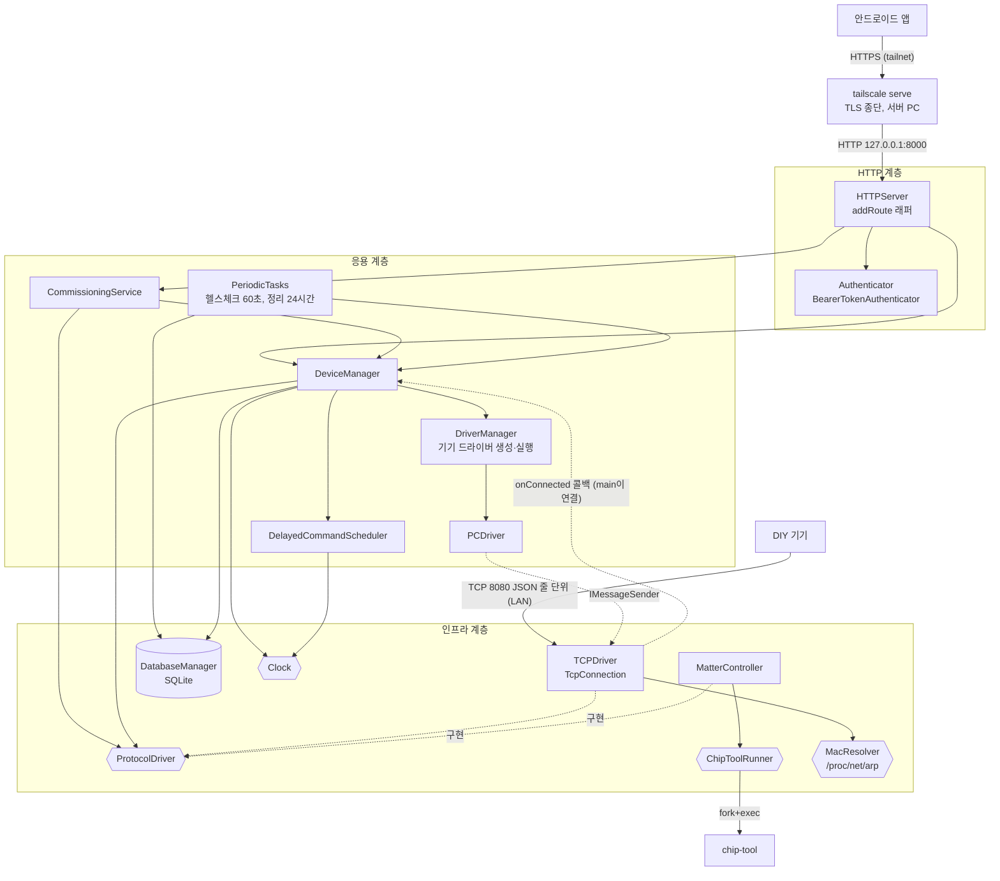
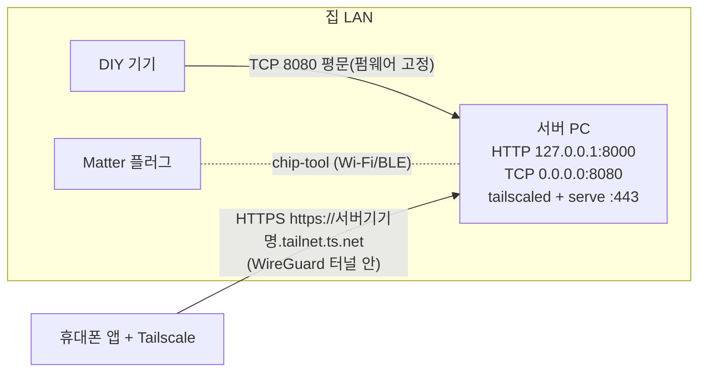
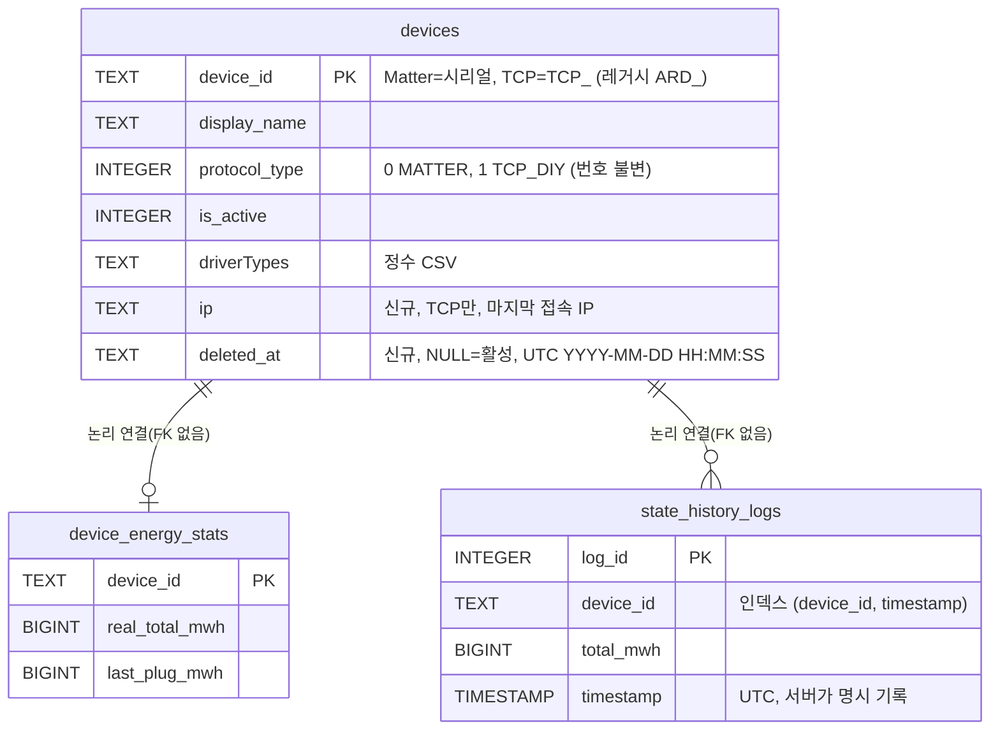
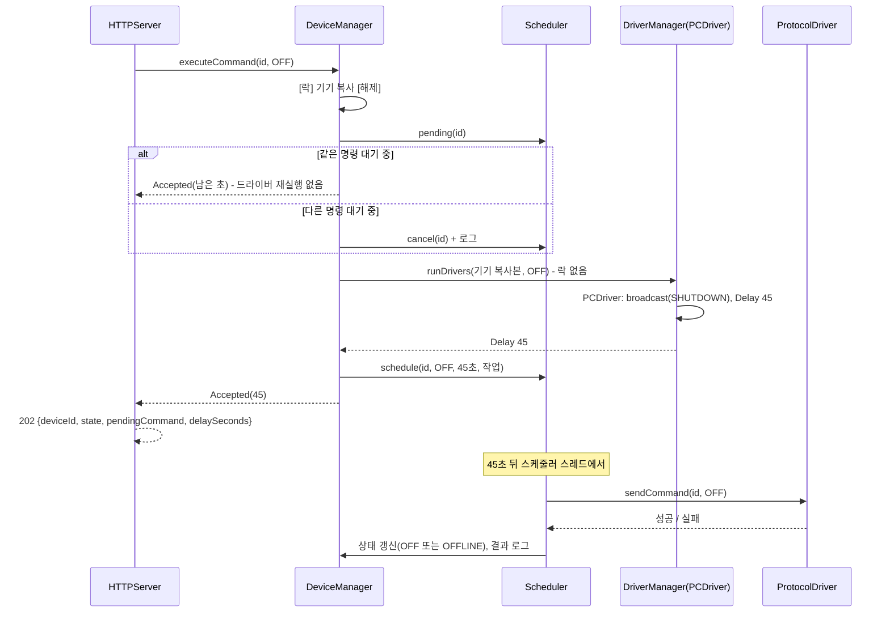
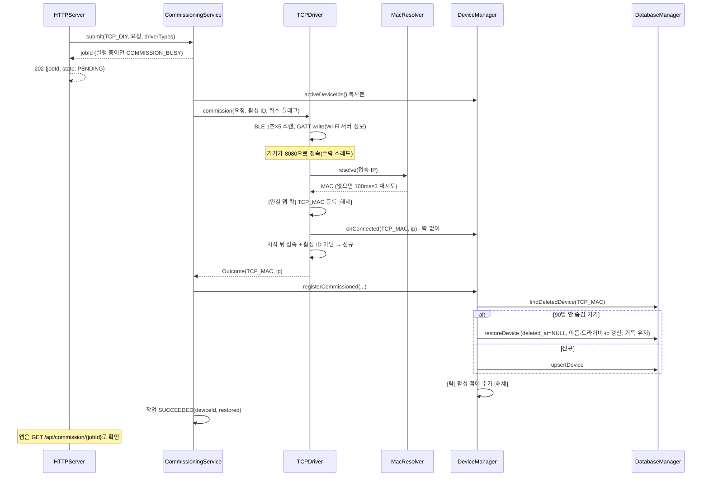
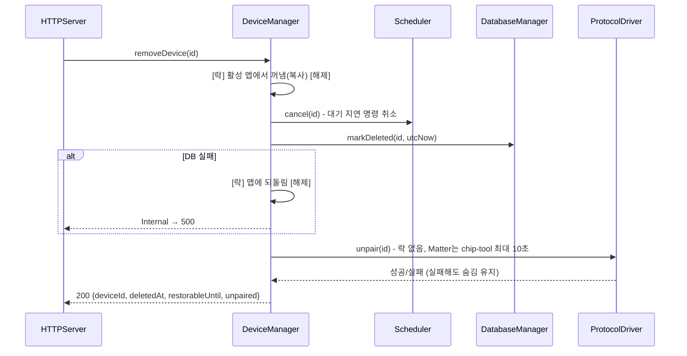

# home-assistant-core — 설계 (To-Be)

| 항목 | 값 |
|---|---|
| 상태 | **초안(사용자 승인 전)** |
| 작성 | 2026-11-17, 2단계 설계 |
| 입력 | `docs/01_요구사항.md`(승인), `docs/03_설계결정/Q-선택지-초안.md`(사용자 결정 2026-11-17), `analysis/as-is-설계.md`·`analysis/문제점.md`(기준 4875445), `docs/api-contract.md` v1.0 |
| 관련 문서 | ADR-001~010(`docs/03_설계결정/`), REST 계약 초안 `docs/api-contract-v2.0-초안.md` |

> **ID 표기 주의**: `N-01(신규)`~`N-03(신규)`은 이번 설계 중 새로 찾은 문제(E2 항상 true / E7 순서 설명 오류 / POST 401 끊김)다. "(신규)"가 없는 `N-xx`는 `analysis/문제점.md`의 번호다.
> **확인 필요**: 코드·문서로 확인되지 않은 사실. 추측으로 채우지 않았고 10절에 모았다.

## 0. As-Is → To-Be 요약

| 관점 | As-Is (문제) | To-Be (설계) | 근거 |
|---|---|---|---|
| 객체 생성 | `DeviceManager`·`DatabaseManager`·`DriverManager` 싱글톤, 드라이버가 `DeviceManager&`를 들고 역호출(순환 의존) | 싱글톤 제거, `main.cpp`가 모두 만들고 생성자로 주입(Composition Root). 의존은 위→아래 한 방향 | ADR-001, REQ-07 |
| 락 | 전역 락 보유 중 chip-tool(최대 10초)·다른 컴포넌트 락 호출(교착), Matter 맵 무락 | "한 번에 락 하나, 락 안에서는 메모리만" 규칙 + 스냅샷 복사 | ADR-002, REQ-01·06, NFR-01 |
| 명령 결과 | `bool`(항상 true), 상태코드를 본문 문자열로 결정 | `CommandResult`(성공/수락(지연)/실패) + `ErrorCode` → HTTP 단일 매핑 표 | ADR-003, REQ-07·11 |
| 스레드 수명 | 지연 명령·언페어 `detach`, 종료 코드 도달 불가 | 모든 스레드를 소유하고 join. 지연 명령은 `DelayedCommandScheduler` 1개 스레드, SIGTERM은 `sigwait` | ADR-010, REQ-08·09 |
| TCP 소켓 | 512B 1회 recv, 기기별 락 없음, 재접속 fd 누수, "ALL" 무락 순회 | `TcpConnection`(fd RAII, 줄 버퍼, 기기별 입출력 락), 브로드캐스트는 복사본 순회 | REQ-05 |
| TCP 기기 ID | `ARD_<IP>`(IP가 바뀌면 다른 기기) | `TCP_<Wi-Fi MAC 12자리>`(커널 ARP 표에서 얻음), IP는 `ip` 칸 | ADR-006 |
| 삭제 | 행 삭제, 통계·이력 남음 | 숨김(`deleted_at`), 90일 안 재등록 시 복구, 90일 뒤 완전 삭제 | ADR-007, REQ-13 |
| 이력 | 인덱스·보관 정책 없음, 최신 50건 고정 | 인덱스, 90일 보관, `limit`(50/최대 1000), 기간·일/주/월 집계(+09:00) | ADR-007, REQ-12, APP-REQ |
| 인증 | pre-routing에서 본문 읽기 전 401 → POST 끊김 | 라우트 등록 함수 하나가 인증 래퍼(Decorator)를 강제, 본문 16KiB 제한 | ADR-009, REQ-15, N-03(신규) |
| 외부 접속 | `0.0.0.0:8000` 평문 HTTP | `127.0.0.1:8000` + `tailscale serve`(HTTPS). 8080은 LAN 유지 | ADR-005, REQ-14 |
| 커미셔닝 | 동기, 비밀값이 chip-tool argv에 노출 | 작업 ID 비동기(동시 1개), chip-tool `interactive start` + stdin | REQ-10·16, ADR-008 |
| 테스트 | 없음 | GoogleTest/GoogleMock, 가짜 드라이버·가짜 시계, `ctest` 한 번 | ADR-004, REQ-17 |

## 1. 전체 구조

3계층(Layered Architecture)이다. **HTTP 계층**은 요청을 검증·인증하고 JSON으로 바꾼다. **응용 계층**은 기기 등록·제어·삭제 규칙과 스레드 수명을 가진다. **인프라 계층**은 하드웨어(TCP 소켓, chip-tool, BLE), SQLite, 시계 같은 바깥 세계를 인터페이스 뒤에 숨긴다. 의존은 위에서 아래로만 흐르고, 아래 계층이 위에 알릴 일(TCP 기기 접속)은 `main`이 연결한 콜백(Observer 패턴)으로 전달한다. 테스트에서는 인프라 계층 인터페이스를 가짜(Fake/Mock)로 바꿔 끼운다.



`{{ }}` 모양은 인터페이스(테스트에서 가짜로 교체)다.

## 2. 기술 스택

| 영역 | 선택 | 이유 | 관련 ADR |
|---|---|---|---|
| 언어·빌드 | C++17, CMake (유지) | G-1, NFR-07 | — |
| HTTP | cpp-httplib (유지, 수정 금지) | 이미 사용. 라우트 래퍼로 인증 위치만 바꿈 | ADR-009 |
| JSON | nlohmann/json (유지) | 이미 사용 | — |
| DB | SQLite3 (유지) + `PRAGMA user_version` 스키마 버전 | 표준 기능으로 마이그레이션 단계 기록. 추가 라이브러리 없음 | ADR-007 |
| Matter | chip-tool 외부 실행 (유지), `interactive start` + stdin | 비밀값을 argv에서 뺌. 실기 확인 뒤 확정 | ADR-008 |
| BLE | SimpleBLE (유지) | TCP 커미셔닝 | — |
| 테스트 | GoogleTest + GoogleMock (신규, FetchContent 버전 고정) | 사용자 결정 Q-01 | ADR-004 |
| 동시성 검사 | ThreadSanitizer(GCC/Clang `-fsanitize=thread`, CMake 옵션) | REQ-01 완료 기준. 컴파일러 내장, 추가 설치 없음 | ADR-004 |
| 외부 접속 | Tailscale(개인용 무료) + `tailscale serve` HTTPS | 사용자 결정 Q-02. 별도 프록시 없음 | ADR-005 |

## 3. 모듈 설계

### 3.1 모듈 책임

| 모듈 | 계층 | 책임 | 공개 인터페이스(요약) | 의존 | 기존 코드 |
|---|---|---|---|---|---|
| `main.cpp` | 조립 | 객체 생성·주입·시작 순서, 신호 대기(`sigwait`), 종료 순서 | — | 전부 | 수정(싱글톤 호출 제거) |
| `HTTPServer` | HTTP | 라우트 등록(`addRoute`가 인증·예외·오류 매핑 강제), JSON ↔ 도메인 변환, 본문 크기 제한 | `start()`, `stop()` | DeviceManager, CommissioningService, Authenticator | 수정 |
| `Authenticator` / `BearerTokenAuthenticator` | HTTP | 인증 판정(Strategy 패턴). 구현은 기존 `ApiAuth` 함수 사용 | `isAuthorized(header)` | ApiAuth | 신규(얇은 래퍼) |
| `ErrorMapping` | HTTP | `ErrorCode` → HTTP 상태·코드 문자열 단일 표 | `toHttp(ErrorCode)` | — | 신규 |
| `DeviceManager` | 응용 | 활성 기기 목록(메모리) 소유, 명령 실행 파이프라인(기기 드라이버 → 지연/즉시 → 상태 갱신), 등록·복구·숨김 삭제, 에너지·이력 조회, TCP 접속 시 ID 이전 | 3.2 참고 | ProtocolDriver, DriverManager, DelayedCommandScheduler, DatabaseManager, Clock | 재작성 |
| `CommissioningService` | 응용 | 커미셔닝 작업 1개씩 실행(작업 스레드 1개), 작업 상태 보관(메모리), 취소 | `submit`, `getJob`, `start`, `stop` | ProtocolDriver, DeviceManager | 신규 (REQ-10) |
| `DelayedCommandScheduler` | 응용 | 기기당 지연 명령 1개 보관·취소·만기 실행 | `schedule`, `pending`, `cancel`, `tick`, `start`, `stopAndCancelAll` | Clock | 신규 (REQ-08) |
| `PeriodicTasks` | 응용 | 60초 헬스체크, 시작 시·24시간마다 보관 기간 정리 | `start`, `stop`, `runHealthCheckOnce`, `runPurgeOnce` | DeviceManager, DatabaseManager, Clock | 신규(DeviceManager에서 분리) |
| `DriverManager` | 응용 | 기기 드라이버 생성 레시피 보관, 기기에 부착, 명령 전 실행·결과 합치기 | `registerFactory`, `createDrivers`, `runDrivers` | IDeviceDriver, IMessageSender | 수정(싱글톤·이름 예약 제거 → N-08 해소) |
| `PCDriver` | 응용 | OFF 시 종료 메시지 브로드캐스트 + 45초 지연 요청 | `handleCommand` | IMessageSender | 수정(시그니처만) |
| `TCPDriver` | 인프라 | 8080 수락, `TcpConnection` 맵, 접속 시 MAC으로 ID 결정, BLE 커미셔닝, 브로드캐스트 | `ProtocolDriver`·`IMessageSender` 구현 + `start`, `stop`, `setConnectionListener` | MacResolver, SimpleBLE | 재작성 |
| `TcpConnection` | 인프라 | fd 소유(RAII), 줄 단위 읽기 버퍼, 요청·응답 1쌍 직렬화(입출력 락) | `request(jsonLine, timeout)`, `sendOnly`, `close` | — | 신규 |
| `MacResolver` / `ProcNetArpResolver` | 인프라 | IPv4 → MAC 조회(`/proc/net/arp` 읽기 전용) | `resolve(ip)` | — | 신규 |
| `MatterController` | 인프라 | chip-tool 명령 구성·출력 해석, 시리얼↔노드ID 맵(락 보호), 매핑 파일 | `ProtocolDriver` 구현 + `initialize` | ChipToolRunner | 수정(`IMessageSender` 제거, 맵 락) |
| `ChipToolOutputParser` | 인프라 | chip-tool 출력 문자열 → 값/오류(예외 없음) | `parseOnOff`, `parseActivePower`, `parseEnergy`, `parseSerial` | — | 신규(기존 파싱 코드 이동, CHIP 헤더 불필요) |
| `ChipToolRunner` / `ProcessChipToolRunner` | 인프라 | 셸 없이 fork+exec, stdin 전달, 제한 시간·강제 종료, 종료 시 전체 취소 | `run`, `cancelAll` | — | 신규 |
| `DatabaseManager` | 인프라 | SQLite 연결·자체 뮤텍스, 마이그레이션, CRUD, 정리 작업 | 3.2 참고 | sqlite3 | 수정(싱글톤 제거) |
| `EnergyAggregation` | 응용(순수 함수) | 시계열 → 일/주/월 구간 사용량(+09:00, 월요일 시작) | `aggregate(...)` | — | 신규 |
| `Clock` / `SystemClock` | 인프라 | 현재 시각(steady·UTC). 테스트는 `FakeClock` | `steadyNow`, `utcNow` | — | 신규 |

### 3.2 공개 인터페이스

공통 결과 타입(Result 패턴: 예상 가능한 실패는 예외가 아니라 값으로 돌려준다).

```cpp
// Result.hpp
enum class ErrorCode {
    None, InvalidRequest, UnsupportedOperation, Unauthorized, NotFound,
    DeviceNotFound, JobNotFound, CommandBlocked, CommissionBusy,
    DeviceUnreachable, CommissionFailed, CommissionTimeout, Cancelled, Internal
};
struct Error { ErrorCode code = ErrorCode::None; std::string message; };

struct Status {                       // 값 없는 결과
    Error error;
    bool ok() const { return error.code == ErrorCode::None; }
};
template <typename T>
struct Result {                       // 값 있는 결과
    std::optional<T> value;
    Error error;
    bool ok() const { return error.code == ErrorCode::None; }
};
```

명령 결과(REQ-07, N-01(신규)).

```cpp
enum class Command { On, Off };                       // REST 문자열 "ON"/"OFF"와 1:1
enum class CommandOutcome { Succeeded, Accepted, Failed };
struct CommandResult {
    CommandOutcome outcome;
    Error error;              // Failed일 때만 채움
    std::string state;        // 응답 시점의 기기 상태
    Command pendingCommand;   // Accepted일 때 대기 중인 명령
    int delaySeconds = 0;     // Accepted일 때 남은 지연(초)
};
```

기기 드라이버(기존 이름 유지, 내용 변경).

```cpp
struct DriverResult {
    enum class Action { Proceed, Block, Delay } action = Action::Proceed;
    int delaySeconds = 0;     // Delay일 때만
};
class IDeviceDriver {
public:
    virtual ~IDeviceDriver() = default;
    virtual DriverResult handleCommand(const Device& device, Command command) = 0;
};
class IMessageSender {        // TCPDriver만 구현. MatterController는 구현하지 않는다
public:
    virtual ~IMessageSender() = default;
    virtual Status sendTo(const std::string& deviceId, const std::string& jsonLine) = 0;
    virtual void broadcast(const std::string& jsonLine) = 0;   // 기존 "ALL" 문자열 대체
};
```

프로토콜 드라이버(`DeviceManager&` 역참조 제거 → 순환 의존 해소).

```cpp
struct CommissionRequest { std::string name, payload, ssid, password; }; // password·payload 로그 금지
struct CommissionOutcome { std::string deviceId; std::string ip; };     // ip는 TCP만
struct EnergyReading { int64_t activePower_mW; int64_t cumulative_mWh; };

class ProtocolDriver {
public:
    virtual ~ProtocolDriver() = default;
    virtual Status sendCommand(const std::string& deviceId, Command command) = 0;
    virtual Result<std::string> readState(const std::string& deviceId, bool isManualRefresh) = 0;
    // activeDeviceIds: 호출 시점의 활성 기기 ID 복사본(드라이버가 DeviceManager 락을 잡지 않게)
    virtual Result<CommissionOutcome> commission(const CommissionRequest& request,
                                                 const std::unordered_set<std::string>& activeDeviceIds,
                                                 const std::atomic<bool>& cancelRequested) = 0;
    virtual Status unpair(const std::string& deviceId) = 0;
    // 기본은 미지원. MatterController만 재정의 → dynamic_cast 제거
    virtual Result<EnergyReading> readEnergy(const std::string& deviceId);
};
```

TCP 계층.

```cpp
struct TcpConnectionInfo { std::string deviceId; std::string ip; };
class MacResolver {
public:
    virtual ~MacResolver() = default;
    virtual std::optional<std::string> resolve(const std::string& ipv4) = 0; // "AABBCCDDEEFF"
};
class TCPDriver : public ProtocolDriver, public IMessageSender {
public:
    TCPDriver(int port, MacResolver& macResolver);
    void setConnectionListener(std::function<void(const TcpConnectionInfo&)> listener); // start 전에 1회
    void start();
    void stop();               // listen fd shutdown → accept 해제 → join → 모든 연결 close
    // ProtocolDriver, IMessageSender 구현 ...
};
```

chip-tool 실행.

```cpp
struct ProcessResult { int exitCode = -1; std::string output; bool timedOut = false; bool cancelled = false; };
class ChipToolRunner {
public:
    virtual ~ChipToolRunner() = default;
    virtual ProcessResult run(const std::vector<std::string>& args,
                              const std::string& stdinText,           // 비밀값은 여기로만
                              std::chrono::seconds timeout) = 0;
    virtual void cancelAll() = 0;   // 종료 시: 새 실행 거부 + 실행 중 자식 SIGTERM → 1초 뒤 SIGKILL
};
```

응용 계층.

```cpp
class DeviceManager {
public:
    DeviceManager(DatabaseManager& db, DriverManager& deviceDrivers,
                  DelayedCommandScheduler& scheduler, Clock& clock);
    void registerProtocol(ProtocolType type, ProtocolDriver& driver);   // 부팅 때만(스레드 시작 전)
    Status loadFromDatabase();                                          // 활성 기기만 메모리에

    std::vector<Device> listDevices() const;                            // 숨김 제외
    std::unordered_set<std::string> activeDeviceIds() const;
    CommandResult executeCommand(const std::string& deviceId, Command command);
    Result<std::string> refreshState(const std::string& deviceId, bool isManualRefresh);
    Result<EnergySnapshot> readEnergy(const std::string& deviceId);     // 존재·프로토콜 확인 먼저
    Result<HistoryResult> getEnergyHistory(const std::string& deviceId, const HistoryQuery& query);

    // 커미셔닝 성공 시 CommissioningService가 호출. 숨김 기기면 복구(restored=true)
    Result<RegisterOutcome> registerCommissioned(ProtocolType type, const CommissionOutcome& outcome,
                                                 const std::string& name,
                                                 const std::vector<DriverType>& driverTypes);
    Result<DeleteOutcome> removeDevice(const std::string& deviceId);    // 숨김 삭제
    void onTcpConnected(const TcpConnectionInfo& info);                 // ip 갱신, ARD_<IP> → TCP_<MAC> 이전
    void runHealthCheck();                                              // PeriodicTasks가 호출
};

class DelayedCommandScheduler {
public:
    explicit DelayedCommandScheduler(Clock& clock);
    // 기기당 1개. 이미 있으면 false(중복 방지, REQ-08)
    bool schedule(const std::string& deviceId, Command command, std::chrono::seconds delay,
                  std::function<void()> task);
    std::optional<PendingCommand> pending(const std::string& deviceId) const;
    bool cancel(const std::string& deviceId);
    void tick(std::chrono::steady_clock::time_point now);  // 만기 작업 실행. 테스트는 직접 호출
    void start();                                          // 내부 스레드가 tick 반복
    void stopAndCancelAll();                               // 대기 작업 취소 + 기기별 로그 (Q-06 B)
};

class CommissioningService {
public:
    CommissioningService(DeviceManager& devices, std::unordered_map<ProtocolType, ProtocolDriver*> drivers);
    Result<std::string> submit(ProtocolType type, CommissionRequest request,
                               std::vector<DriverType> driverTypes);   // 실행 중이면 CommissionBusy
    Result<JobStatus> getJob(const std::string& jobId) const;
    void start();
    void stop();                                                       // 취소 요청 + join
};

class Clock {
public:
    virtual ~Clock() = default;
    virtual std::chrono::steady_clock::time_point steadyNow() const = 0;  // 타이머용
    virtual std::chrono::system_clock::time_point utcNow() const = 0;     // 기록 시각용
};
```

HTTP 계층.

```cpp
class Authenticator {
public:
    virtual ~Authenticator() = default;
    virtual bool isAuthorized(const std::string& authorizationHeader) const = 0;
};
struct ApiResponse { int httpStatus; nlohmann::json body; };
using RouteHandler = std::function<ApiResponse(const httplib::Request&)>;

class HTTPServer {
public:
    HTTPServer(DeviceManager&, CommissioningService&, const Authenticator&,
               std::string bindAddress, int port);
    bool start();
    void stop();               // svr.stop() 호출 후 join (As-Is의 N-12 해소)
private:
    // 모든 라우트는 이 함수로만 등록: 인증 → 핸들러 → 예외는 500 → JSON 직렬화
    void addRoute(HttpMethod method, const std::string& pattern, RouteHandler handler);
};
```

`DatabaseManager`(싱글톤 제거, 내부 뮤텍스): `open(path)`(마이그레이션 포함), `upsertDevice`, `loadActiveDevices`, `findDeletedDevice`, `markDeleted`, `restoreDevice`, `updateDeviceState`, `updateDeviceIp`, `renameDeviceId(old, new)`(트랜잭션), `updateEnergyStat`, `insertEnergyLog(id, total, utcTime)`, `queryHistory(id, fromUtc, toUtc, limit)`, `purgeExpired(cutoffUtc)`, `close`.

### 3.3 명령 실행 규칙 (REQ-07·08, N-01(신규))

| 단계 | 규칙 |
|---|---|
| 1 | 기기 없음/숨김 → `Failed(DeviceNotFound)` |
| 2 | 대기 중 지연 명령이 있고 **같은 명령** → 기기 드라이버를 다시 실행하지 않고 `Accepted(남은 초)` (종료 메시지·타이머 중복 없음) |
| 3 | 대기 중 지연 명령이 있고 **다른 명령**(예: OFF 대기 중 ON) → 지연 명령 취소, 로그, 계속 진행 |
| 4 | 기기 드라이버 실행: `Block` 하나라도 → `Failed(CommandBlocked)`, `Delay` 최댓값 → 스케줄러 등록 후 `Accepted` |
| 5 | 즉시 실행: 프로토콜 `sendCommand` 성공 → 상태 갱신 → `Succeeded`. 실패 → 상태 `OFFLINE` → `Failed(DeviceUnreachable)`. `Cancelled`(종료 중) → 상태 갱신 안 함 |
| 6 | 지연 작업 만기 시 5와 같게 실행(결과는 로그·상태로만 남음, 앱은 E5로 확인) |

### 3.4 스레드·락 규칙 (REQ-01·06, NFR-01)

**스레드** (As-Is의 detach 스레드 2종 제거)

| 스레드 | 소유자 | 하는 일 | 종료 방법 |
|---|---|---|---|
| main | — | 조립 후 `sigwait(SIGTERM, SIGINT)` | 신호 수신 → 3.6 순서 |
| HTTP listen + 작업 풀 | HTTPServer(httplib) | 요청 처리 | `svr.stop()` |
| TCP 수락 | TCPDriver | `accept`, MAC 조회, 연결 등록, 콜백 호출 | listen fd `shutdown` → join |
| 지연 명령 | DelayedCommandScheduler | 만기 작업 실행 | 조건변수 깨움 → join |
| 주기 작업 | PeriodicTasks | 헬스체크 60초, 정리 24시간 | 조건변수 깨움 → join |
| 커미셔닝 | CommissioningService | 작업 1개씩 | 취소 플래그 → join |

신호는 다른 스레드를 만들기 전에 `pthread_sigmask`로 막고 main만 `sigwait`로 받는다(신호 처리기 안에서 할 수 있는 일이 거의 없다는 제약을 피하는 표준 방법).

**락 목록**

| 락 | 종류 | 보호 대상 | 보유 중 허용 |
|---|---|---|---|
| `DeviceManager::mutex_` | 상태 락 | 활성 기기 맵 | 메모리 읽기·쓰기만 |
| `TCPDriver::connectionsMutex_` | 상태 락 | `deviceId → shared_ptr<TcpConnection>` | 메모리만 |
| `TcpConnection::ioMutex_` | 자원 락 | 한 소켓의 요청·응답 1쌍 | 그 소켓 송수신(최대 1초) |
| `MatterController::stateMutex_` | 상태 락 | `mSerialToNodeId`, `mOfflineNodes`, `mPairingNodes` | 메모리만 |
| `MatterController::fileMutex_` | 자원 락 | `registered_devices.txt` 쓰기 | 그 파일 쓰기 |
| `DelayedCommandScheduler::mutex_` | 상태 락 | 대기 작업 표 | 메모리만(작업은 락 밖에서 실행) |
| `CommissioningService::mutex_` | 상태 락 | 작업 상태 표 | 메모리만 |
| `DatabaseManager::mutex_` | 자원 락 | sqlite3 연결 | SQLite 호출 |

**규칙**

| # | 규칙 | 막는 문제 |
|---|---|---|
| L-1 | **한 번에 락 하나**. 락을 쥔 채 다른 락을 잡는 함수(다른 컴포넌트 메서드 포함)를 부르지 않는다. 중첩이 없으므로 순환 대기(교착)가 생길 수 없다 | N-01(교착) |
| L-2 | 상태 락 안에서는 메모리만 다룬다. DB·소켓·프로세스 실행·sleep·콜백 호출 금지 | B-07, REQ-06 |
| L-3 | 자원 락은 그 자원의 입출력에만 쓰고, 쥔 채 다른 락을 잡지 않는다 | REQ-05(b) |
| L-4 | 밖에서 쓸 데이터는 락 안에서 복사(스냅샷)하고 락을 푼 뒤 사용한다. 연결 객체는 `shared_ptr`로 복사해 순회 중 삭제에도 수명 유지 | B-04, REQ-05(d) |
| L-5 | 콜백(`onConnected`)과 기기 드라이버(`handleCommand`)는 락 없이 호출한다 | N-01 |
| L-6 | 스레드는 소유하고 join한다. `detach` 금지 | N-13, REQ-09 |
| L-7 | 나중에 중첩이 꼭 필요해지면 순서는 `DeviceManager → Scheduler → TCPDriver(연결 맵) → TcpConnection → MatterController → Database`로만 잡고 이 표를 갱신한다 | 확장 대비 |

메모리와 DB 갱신은 락 밖에서 순서대로 한다(메모리 → DB 또는 DB → 메모리, 흐름마다 5절에 명시). 같은 기기에 대한 두 상태 갱신이 DB에 역순으로 쓰일 수 있으나 `is_active` 1칸이고 60초 헬스체크가 바로잡으므로 감수한다(ADR-002).

### 3.5 오류 응답 규약 (REQ-11, I-01~I-05)

- 상태코드는 핸들러가 돌려준 `ErrorCode`로만 정한다(본문 문자열 검사 제거, I-05).
- 오류 본문은 하나: `{"error": {"code": "DEVICE_NOT_FOUND", "message": "등록되지 않은 기기입니다."}}`. 앱은 `code`로 분기, `message`는 표시용.
- 성공 본문에는 `result`/`status`/`message` 같은 처리 결과 키를 두지 않는다(HTTP 코드가 결과).
- 키는 lowerCamelCase. 단, 단위 접미사는 대소문자가 뜻을 가르므로(`mW` 밀리와트 ≠ `MW` 메가와트) 기존 `_mW`, `_mWh`를 유지한다.

| ErrorCode | 코드 문자열 | HTTP | 쓰는 곳 |
|---|---|---|---|
| InvalidRequest | `INVALID_REQUEST` | 400 | JSON 오류, 필드 누락, 허용 안 된 명령, 파라미터 형식·범위 |
| UnsupportedOperation | `UNSUPPORTED_OPERATION` | 400 | TCP 기기에 E6·E7 |
| Unauthorized | `UNAUTHORIZED` | 401 | 인증 실패(+`WWW-Authenticate: Bearer`) |
| NotFound | `NOT_FOUND` | 404 | 없는 경로(인증 뒤) |
| DeviceNotFound | `DEVICE_NOT_FOUND` | 404 | 없는 기기·숨김 기기 (I-02) |
| JobNotFound | `JOB_NOT_FOUND` | 404 | 없는 커미셔닝 작업 |
| CommandBlocked | `COMMAND_BLOCKED` | 409 | 기기 드라이버가 명령을 막음 |
| CommissionBusy | `COMMISSION_BUSY` | 409 | 커미셔닝이 이미 실행 중 |
| (httplib) | `PAYLOAD_TOO_LARGE` | 413 | 본문 16KiB 초과(본문 모양은 확인 필요, 10절) |
| Internal | `INTERNAL_ERROR` | 500 | 예상 못 한 예외, DB 오류 |
| DeviceUnreachable | `DEVICE_UNREACHABLE` | 502 | 기기·chip-tool 응답 없음/실패 (I-01) |
| CommissionFailed / CommissionTimeout / Cancelled | `COMMISSION_FAILED` / `COMMISSION_TIMEOUT` / `CANCELLED` | (작업 상태 안) | E8 작업 결과의 `error.code` |

### 3.6 종료 순서 (REQ-09, Q-06 B: 5초 안, 종료 코드 0)

| 순서 | 동작 | 상한 |
|---|---|---|
| 0 | 신호 수신 로그, `ChipToolRunner::cancelAll()`(실행 중 chip-tool 종료 → 진행 중 요청이 `Cancelled`로 빨리 끝남, 상태는 갱신 안 함) | 1초 |
| 1 | `HTTPServer::stop()` — 새 요청 거부, 진행 중 요청 마무리 | ~1초 |
| 2 | `CommissioningService::stop()` — 취소 플래그. BLE 스캔은 1초씩 나눠 5회 하므로 1초 안에 멈춤 | 1초 |
| 3 | `TCPDriver::stop()` — 수락 종료, 연결 close | <1초 |
| 4 | `DelayedCommandScheduler::stopAndCancelAll()` — 대기 중 지연 OFF 취소, 기기별 `[Scheduler] 종료로 지연 명령 취소: <id> OFF` 로그 / `PeriodicTasks::stop()` | <1초 |
| 5 | `DatabaseManager::close()` → `return 0` | <1초 |

REQ-09의 순서(HTTP → TCP → 헬스체크·지연 → DB)를 지키고 0·2를 끼워 넣었다. 지연 OFF를 실행하지 않고 취소하므로 서버 종료가 PC 전원 차단을 일으키지 않는다(Fail-safe).

### 3.7 인증·본문 제한 (REQ-15, N-03(신규))

| 항목 | 설계 |
|---|---|
| 인증 위치 | `addRoute` 래퍼 안(본문을 읽은 뒤). pre-routing 핸들러는 쓰지 않는다. 마지막에 전체 경로 매칭 라우트(`.*`)를 래퍼로 등록해 없는 경로도 인증 뒤 404 |
| 본문 제한 | `svr.set_payload_max_length(16 * 1024)`. 가장 큰 E3도 1KiB 안팎 |
| 실패 로그 | `[HTTPServer] 인증 실패: <remote_addr> <method> <path>` + `X-Forwarded-For`가 있으면 함께(토큰은 일부도 남기지 않음). serve 뒤에서는 `remote_addr`가 127.0.0.1이다 |
| 토큰 교체 | 토큰 파일 교체 후 재시작(문서화). 다중 토큰은 범위 밖 |
| 시도 횟수 제한 | 구현하지 않음. VPN 안에서만 접근(ADR-005). 외부 노출로 바꾸면 래퍼에 추가하는 지점만 남김 |

### 3.8 테스트 구조 (REQ-17)

| 종류 | 대상 | 가짜 | 예 |
|---|---|---|---|
| 단위 | `ChipToolOutputParser`, TCP 줄 조립, ARP 표 파싱, 에너지 보정, `EnergyAggregation`, `ErrorMapping`, 레거시 ID 판별, `DelayedCommandScheduler::tick` | `FakeClock` | REQ-02·03·05(a)·12, APP-REQ |
| 통합 | `DeviceManager`+`CommissioningService`+`DatabaseManager(":memory:")` | `FakeProtocolDriver`(지연·실패·예외·OFFLINE 재현, 손으로 작성), `MockMessageSender`(GoogleMock), `FakeMacResolver` | REQ-01·04·06·07·08·10·13 |
| 통합(소켓) | `TCPDriver`를 루프백 포트로 | 테스트가 TCP 클라이언트로 기기 흉내, `FakeMacResolver` | REQ-05(b)(c)(d), NFR-04 회귀(고정 JSON 샘플) |
| 통합(HTTP) | `HTTPServer`를 임시 포트로, httplib 클라이언트로 호출 | 가짜 드라이버 | REQ-11 표 기반, N-03(신규) POST 401 |
| 통합(DB) | v0 스키마 샘플 DB → 마이그레이션 | — | NFR-06 |
| TSan | 위 통합 테스트를 `-DHAC_ENABLE_TSAN=ON` 빌드로 | — | REQ-01, NFR-01 |
| 실기 | `docs/07_실기시험.md`(REQ-18, 사용자 실행) | — | REQ-05·08·09·10·14·16, ADR-006 확인 항목 |

빌드는 `hac_core`(CHIP·SimpleBLE 불필요) / `hac_drivers`(TCPDriver, MatterController) / `HomeAssistantCore`(main) / `hac_tests`로 나눈다. 경고 옵션 `-Wall -Wextra`는 우리 대상에만(외부 헤더 제외). 실행은 `ctest --test-dir build`.

### 3.9 배포 토폴로지 (REQ-14, ADR-005)



| 항목 | 값 |
|---|---|
| HTTP 바인딩 | 기본 `127.0.0.1:8000`. 환경 변수 `HAC_HTTP_BIND`로 바꿀 수 있음(전환기·비상용) |
| HTTPS | `tailscale serve --bg 8000`(정확한 명령은 설치 버전으로 실기 확인), Tailscale이 발급한 `*.ts.net` 인증서 |
| TCP 8080 | `0.0.0.0` 유지(LAN 기기용). 공유기 포트포워딩 없음 |
| 외부 포트 | 열지 않음 |
| 전환기 | 바인딩을 `0.0.0.0`으로 두고 serve를 켠 상태에서 앱 주소를 HTTPS로 바꾼 뒤 `127.0.0.1`로 좁힌다(계약 초안 §7) |

## 4. 데이터 모델



### 4.1 스키마 변경

| 변경 | SQL | 이유 |
|---|---|---|
| 스키마 버전 | `PRAGMA user_version` (현재 DB = 0 → 1) | 마이그레이션 단계 기록(NFR-06) |
| `devices.ip` | `ALTER TABLE devices ADD COLUMN ip TEXT` | 고정 ID와 IP 분리(ADR-006) |
| `devices.deleted_at` | `ALTER TABLE devices ADD COLUMN deleted_at TEXT` | 숨김 삭제(ADR-007) |
| 이력 인덱스 | `CREATE INDEX IF NOT EXISTS idx_history_device_time ON state_history_logs(device_id, timestamp)` | REQ-12, 기간 조회 |
| 시각 기록 | `insertEnergyLog`가 `Clock::utcNow()`를 같은 문자열 형식으로 직접 넣음(기본값 `CURRENT_TIMESTAMP`는 남겨 둠) | 가짜 시계 시험, 형식 호환 |
| 외래키 | 추가 안 함 | SQLite는 FK 추가 시 테이블 재작성 필요, ID 이전(rename)과 충돌. 정리는 코드가 3개 테이블을 한 트랜잭션으로 처리 |

### 4.2 마이그레이션 절차 (시작 시 자동, NFR-06)

| 단계 | 동작 |
|---|---|
| 1 | `user_version` 읽기. 목표(1)보다 작으면 DB 파일을 `home_assistant.db.bak-v<현재>`로 복사(실패 시 시작 중단) |
| 2 | 트랜잭션: 4.1의 ALTER·INDEX 실행 → `UPDATE devices SET ip = substr(device_id, 5) WHERE protocol_type = 1 AND device_id LIKE 'ARD_%'` → `PRAGMA user_version = 1` |
| 3 | 실패 시 롤백·로그·종료(데이터 그대로) |
| 4 | **레거시 ID 이전은 실행 중 지연 처리**: MAC은 기기가 접속해야 알 수 있다. `onTcpConnected(TCP_<MAC>, ip)` 때 `TCP_<MAC>` 기기가 없고 `ARD_<ip>`(활성 또는 숨김)가 있으면 `renameDeviceId`로 3개 테이블의 `device_id`를 한 트랜잭션에서 바꾸고 메모리 맵 키도 바꾼다. 로그 `[DeviceManager] ID 이전: ARD_x → TCP_y` |
| 5 | 이전 전 IP가 이미 바뀐 기기는 짝을 못 찾는다 → 앱에서 삭제 후 다시 등록(안내 문서화) |

`registered_devices.txt`(Matter `serial,nodeId`)는 형식·위치를 바꾸지 않는다.

### 4.3 정리 작업 (`PeriodicTasks`, 시작 시 + 24시간마다, 한 트랜잭션)

```sql
-- :cutoff = utcNow - 90일
DELETE FROM state_history_logs WHERE timestamp < :cutoff;
DELETE FROM device_energy_stats WHERE device_id IN (SELECT device_id FROM devices WHERE deleted_at < :cutoff);
DELETE FROM state_history_logs  WHERE device_id IN (SELECT device_id FROM devices WHERE deleted_at < :cutoff);
DELETE FROM devices WHERE deleted_at < :cutoff;
```

숨김 기기는 메모리 맵에 없으므로 정리는 DB만 건드린다. 시각 문자열이 같은 형식이라 문자열 비교가 시간 순서와 같다.

## 5. 주요 흐름

### 5.1 제어 `POST /api/control` (지연·취소·중복, REQ-07·08)



### 5.2 비동기 커미셔닝 + 고정 ID·복구 (TCP_DIY, REQ-10·13, ADR-006·007)



Matter도 같은 흐름이며 `commission`이 chip-tool 페어링 → 시리얼 읽기로 ID를 얻는다. 숨김 삭제 때 이미 unpair했으므로 재등록 = 재페어링, 같은 시리얼이면 복구된다.

### 5.3 숨김 삭제 `POST /api/devices/delete` (REQ-13)



## 6. 요구사항 대응표

| ID | 담당 모듈 | 설계 대응 | 릴리스 |
|---|---|---|---|
| REQ-01 | 전체, MatterController | 3.4 L-1~L-7, Matter `stateMutex_`, 커미셔닝에 활성 ID 복사본 전달, 삭제 시 unpair 락 밖 | 1차 |
| REQ-02 | ChipToolOutputParser, PeriodicTasks | 파싱은 예외 없이 `Result`, 헬스체크는 기기별 try/catch, 부팅 `stoull` 검증(N-11) | 1차 |
| REQ-03 | DeviceManager, DatabaseManager | 조회 실패 시 `updateEnergyStat` 호출 안 함, `insertDevice` step 1회 | 1차 |
| REQ-04 | DeviceManager | `readEnergy`가 존재·프로토콜 확인 후 드라이버 호출, DB는 성공 시에만 | 1차 |
| REQ-05 | TCPDriver, TcpConnection | 줄 버퍼, `ioMutex_`, fd RAII·재접속 시 이전 연결 close, 브로드캐스트 복사본 | 1차 |
| REQ-06 | DeviceManager | 기기 복사 후 락 밖에서 chip-tool | 1차 |
| REQ-07 | DeviceManager, 인터페이스 전부 | 3.2, 3.3, 생성자 주입, 가짜 드라이버 | 1차 |
| REQ-08 | DelayedCommandScheduler | 3.3 단계 2·3, `tick` + FakeClock | 2차 |
| REQ-09 | main, 각 stop | 3.6 | 2차 |
| REQ-10 | CommissioningService | 작업 ID·상태 조회, 동시 1개, BLE 예외 포착, E3/E8 | 2차 |
| REQ-11 | HTTPServer, ErrorMapping | 3.5, 계약 v2.0 MAJOR 목록 | 2차 |
| REQ-12 | DatabaseManager, EnergyAggregation | 인덱스, 90일 정리, limit 50/1000, 기간·집계 | 2차 |
| REQ-13 | DeviceManager, DatabaseManager | 숨김 삭제·복구·90일 완전 삭제. **완료 기준 변경 필요(10절)** | 2차 |
| REQ-14 | 배포, HTTPServer 바인딩 | 3.9, ADR-005, 가이드는 `docs/06_배포.md`(구현 단계) | 1차 |
| REQ-15 | HTTPServer, Authenticator | 3.7 | 2차 |
| REQ-16 | MatterController, ChipToolRunner | stdin 전달(ADR-008), 실패 시 위험 문서화 | 2차 |
| REQ-17 | tests/, CMake | 3.8, ADR-004 | 1차 |
| REQ-18 | docs | `docs/07_실기시험.md`(이름 확인 필요) | 1차 |
| NFR-01 | 전체 | 3.4, TSan | 1차 |
| NFR-02 | DeviceManager, HTTPServer | E1·E5(비수동)는 메모리/짧은 경로, 느린 작업은 락 밖·별도 스레드. 기준 1초 | 1차 |
| NFR-03 | 전체 | 비밀값은 stdin·메모리만, 로그 금지, TLS는 serve, LAN 평문 제거 | 1·2차 |
| NFR-04 | TCPDriver | JSON 메시지 문자열 그대로, 고정 샘플 회귀 테스트. ID 결정은 서버 쪽 정보(ARP)만 사용 | 1차 |
| NFR-05 | ProtocolDriver, DriverManager | 인터페이스 주입, 드라이버 추가 절차 CLAUDE.md 갱신(구현 단계) | 1차 |
| NFR-06 | DatabaseManager | 4.2 | 1·2차 |
| NFR-07 | CMake | 라이브러리 분리, FetchContent | 1차 |
| I-01 | DeviceManager, ErrorMapping | `CommandResult` → 200/202/502/409 | 2차 |
| I-02 | ErrorMapping | 없는 기기 404 통일 | 2차 |
| I-03 | HTTPServer | 단일 오류 본문, 키 표기 규칙 | 2차 |
| I-04 | CommissioningService | E3 202 + E8 | 2차 |
| I-05 | HTTPServer | `ErrorCode`로 상태 결정 | 2차 |
| I-06 | 배포 | serve HTTPS, 127.0.0.1 바인딩 | 1차(설정) |
| N-01(신규) | DeviceManager | `CommandResult`. 1차에서는 v1.0 문서대로 실패 시 "명령 실패!" | 1차 |
| N-02(신규) | 계약서 | 설명 정정(최신 N건을 오래된 순). 코드 동작 유지 | 2차(문서) |
| N-03(신규) | HTTPServer | 인증 래퍼(본문 읽은 뒤) | 2차 |
| APP-REQ | DatabaseManager, EnergyAggregation | E7 `from/to/period/limit` | 2차 |

1차 릴리스는 REST v1.0을 유지한다(내부 재설계만). REST 변경은 2차에 v2.0으로 한 번에 낸다(계약 초안 §7).

## 7. 폴더 구조

기존 평평한 `src/`·`include/` 구조를 유지하고(파일 이동으로 이력이 흐려지는 것 방지) 새 파일만 더한다.

```
CMakeLists.txt          hac_core / hac_drivers / HomeAssistantCore / hac_tests, HAC_ENABLE_TSAN 옵션
include/                기존 헤더 + Result.hpp, Command.hpp, Clock.hpp, Authenticator.hpp,
                        ErrorMapping.hpp, DelayedCommandScheduler.hpp, PeriodicTasks.hpp,
                        CommissioningService.hpp, TcpConnection.hpp, MacResolver.hpp,
                        ChipToolRunner.hpp, ChipToolOutputParser.hpp, EnergyAggregation.hpp
src/                    대응 .cpp (httplib.h, json.hpp 그대로)
tests/
  unit/                 *_test.cpp (파서, 집계, 보정, 매핑, 스케줄러)
  integration/          DeviceManager, TCP 루프백, HTTP, 마이그레이션
  fakes/                FakeProtocolDriver, FakeClock, FakeMacResolver, FakeChipToolRunner, MockMessageSender
  data/                 v0 스키마 샘플 DB 생성 SQL, TCP JSON 고정 샘플, /proc/net/arp 샘플
docs/                   02_설계.md, 03_설계결정/ADR-*.md, api-contract.md(v1.0), api-contract-v2.0-초안.md
```

## 8. 구현 순서

| # | 작업 | REQ | 릴리스 |
|---|---|---|---|
| 1 | CMake 분리·경고 옵션·GoogleTest·`ctest`·TSan 옵션 (기존 동작 불변) | REQ-17, NFR-07 | 1차 |
| 2 | `Result`/`ErrorCode`/`Clock`, `ChipToolOutputParser` 분리 + 단위 테스트 | REQ-02 | 1차 |
| 3 | `DatabaseManager` 뮤텍스·싱글톤 제거·insert 1회·마이그레이션 v1(칸·인덱스 추가만) | REQ-03, NFR-06 | 1차 |
| 4 | 인터페이스 재정의, `DeviceManager` 주입, `FakeProtocolDriver`, `main` 조립·시작 순서 | REQ-07, NFR-05 | 1차 |
| 5 | 락 규칙 적용(Matter 맵, 삭제·커미셔닝 경로), TSan 통과 | REQ-01·06 | 1차 |
| 6 | 에너지 경로(존재 확인 선행, 실패 미갱신) | REQ-03·04 | 1차 |
| 7 | `TcpConnection`·브로드캐스트 | REQ-05 | 1차 |
| 8 | `ChipToolRunner`(셸 제거, 제한 시간) | REQ-06·09 준비 | 1차 |
| 9 | 바인딩 설정 + serve 가이드 + 실기 절차서 | REQ-14·18 | 1차 |
| 10 | HTTP 래퍼·오류 규약·본문 제한 (v2.0 응답) | REQ-11·15, N-03(신규) | 2차 |
| 11 | 스케줄러, SIGTERM 종료 | REQ-08·09 | 2차 |
| 12 | 고정 ID(ARP)·레거시 이전, 숨김 삭제·정리, E7 기간·집계 | REQ-12·13, APP-REQ | 2차 |
| 13 | 비동기 커미셔닝, chip-tool stdin(실기 확인 뒤) | REQ-10·16 | 2차 |
| 14 | 계약 v2.0 확정 → 앱 반영(계약 초안 §7 순서) | REQ-11 | 2차 |

## 9. 리뷰 반영

| 출처 (Gemini / 보안 / 사용자) | 지적 | 반영 여부 | 이유 |
|---|---|---|---|
| 사용자(2026-11-17) | Q-02b 프록시 미사용, 필요 시 `tailscale serve` | 반영 | ADR-005 |
| 사용자(2026-11-17) | Q-03c 고정 ID + 숨김 삭제(90일 복구) | 반영 | ADR-006·007. REQ-13 완료 기준과 충돌 → 10절 |
| 보안 점검 / Gemini 교차 리뷰 | (아직 없음, `reviews/` 없음) | — | 설계 검토 단계에서 받은 뒤 이 표에 기록 |

## 10. 확인 필요 · 요구사항 변경 필요

| # | 항목 | 확인 방법 | 영향 |
|---|---|---|---|
| C-1 | DIY 기기 접속 직후 `/proc/net/arp`에 그 IP의 MAC이 있는지, 재부팅·공유기 재부팅 뒤에도 같은 MAC인지 | 실기: `cat /proc/net/arp` 전후 비교 | ADR-006 성립 여부 |
| C-2 | 공유기·중계기가 MAC을 바꿔 전달(MAC NAT/프록시 ARP)하는지 — 여러 기기가 같은 MAC으로 보이면 불가 | 실기: 기기 2대 이상일 때 ARP 표 비교 | ADR-006 |
| C-3 | 펌웨어가 Wi-Fi MAC을 바꾸거나 무작위로 쓰는지(ESP32 기본은 공장 MAC이지만 펌웨어 설정에 따라 다름, 단정 안 함) | C-1 반복으로 간접 확인 | ADR-006 |
| C-4 | BLE 주소(SimpleBLE `address()`)와 Wi-Fi MAC의 관계(ESP32는 흔히 +2, 보드 의존) | 실기: 커미셔닝 로그의 BLE 주소와 ARP MAC 비교(참고용 로그만 남김) | 진단용, 설계는 의존 안 함 |
| C-5 | 서버가 연결을 닫으면 펌웨어가 다시 접속하는지, 응답을 여러 줄로 보내는지 | 실기 | REQ-05, ADR-006 대체 처리 |
| C-6 | chip-tool `interactive start`에 stdin 파이프로 명령을 주면 실행되는지, 공백·특수문자가 든 SSID/비밀번호를 어떻게 따옴표 처리하는지, 종료 감지 방법 | 실기(사용자) | ADR-008 |
| C-7 | Matter 페어링 실제 소요 시간(작업 제한 시간 120초 초안), 재페어링 후 누적 전력량 카운터가 이어지는지 | 실기 | REQ-10, ADR-007 |
| C-8 | `tailscale serve`가 `X-Forwarded-For`를 붙이는지, 개인용 무료 요금제에서 HTTPS 인증서 사용 설정, 명령 형식(버전별) | 실기 | 3.7 로그, ADR-005 |
| C-9 | httplib 작업 풀 크기, 413 응답 본문 모양·연결 처리, `svr.stop()`이 진행 중 요청을 기다리는 방식 | httplib 문서(헤더는 읽지 않음) 또는 통합 테스트 | 3.5·3.6 |
| C-10 | N-03(신규) 원인 추정(pre-routing 401 후 RST)이 맞는지 | 통합 테스트(수정 전 실패 재현) | ADR-009 |
| C-11 | 앱이 기기 ID를 불투명 문자열로만 다루는지(`ARD_` 파싱 여부), 설정에서 HTTPS 전체 주소를 받을 수 있는지 | 앱 팀(총괄 중개) | 계약 §7 |
| **R-1** | **REQ-13 완료 기준 "재등록 후 누적값이 0에서 시작"이 사용자 결정(90일 안 재등록 시 기록 이음)과 반대** | 사용자 승인 후 `01_요구사항.md` 수정(PM) | REQ-13 |
| **R-2** | REQ-14 문구 "리버스 프록시"를 `tailscale serve`(TLS 종단 역할)로 읽는 것에 대한 확인 | 사용자 | REQ-14 |
| **R-3** | N-10(범위 밖이었던 TCP 커미셔닝 아무 소켓 채택)이 고정 ID로 일부 해소됨 → 범위 기록 | PM | 01_요구사항 6절 |
